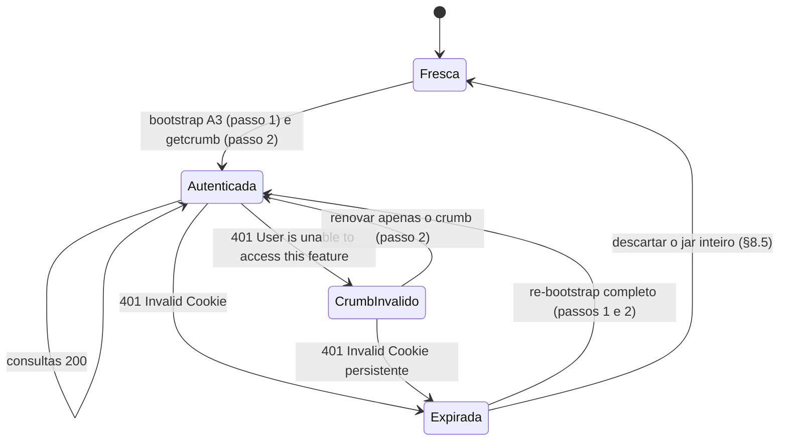

# Engenharia Reversa — Autenticação: 🔑 Cookie A3 + Crumb + GUC

Escopo: o mecanismo de autenticação anônima do Yahoo Finance baseado no trio **Cookie A3 + Crumb + GUC** — a identidade de sessão anônima (A3), o token de prova (Crumb) e o estado de consentimento embutido no payload do cookie (GUC). Cobre a máquina de estados de autenticação (o estado canônico e o fallback de consentimento), a anatomia e a decodificação binária (TLV) do cookie, o transporte do site com injeção de crumb e as camadas anti-bot. O único consumidor exemplificado é a cotação de ações (`/v7/finance/quote`); crumbs de escopo próprio (serviços como checkout de convidado e jsapi) ficam de fora. A infraestrutura de entrega (stores Svelte, `fin-streamer`, SSE, Service Worker, telemetria) fica de fora, salvo quando toca o transporte autenticado. O código transcrito é real, integral e extraído do bundle servido pelo site; cada bloco cita o arquivo de origem com os nomes minificados preservados.

---

## 1. O par A3 + Crumb

O **Cookie A3** é o identificador de sessão anônima do ecossistema Yahoo e a âncora de identidade sobre a qual o backend emite tokens derivados. Não carrega autenticação de usuário, e o cliente nunca o gera nem o valida — só o servidor o assina e reconhece. É emitido na primeira visita e reafirmado nas seguintes com o mesmo payload `d=` (§4.1).

O **Crumb** é o token derivado: um token CSRF casado à sessão emissora, com 11 caracteres, devolvido como corpo `text/plain` por `GET /v1/test/getcrumb`. O alfabeto não é restrito a alfanuméricos — observados `.` e `/`, inclusive em posição interna (`lax.8XtR/A…`) — e o bootstrap do cliente não valida formato (§6). **A emissão em si não exige cookie**: sem nenhum cookie o endpoint devolve `200` com um crumb anônimo de 11 caracteres — mas esse token só é **aceito no consumo** em par com a sessão emissora; sem o par, os endpoints protegidos recusam com 401 `Invalid Crumb`. Com o par trocado entre sessões, o token também é recusado no consumo. Envelopes, status e ações de cada caso estão no §9.

Persistir uma sessão exige salvar **cookie jar e crumb juntos**, como par atômico — nunca misturados entre sessões. Ao validar o casamento, varie a URL a cada tentativa: a resposta de mercado é cacheada pela URL completa (símbolos + crumb), e repetir a mesma URL com outro cookie devolve o corpo cacheado com `200`, mascarando o `401`.

### 1.1 A família A1 / A1S / A3 (+ GUC)

O A3 nunca anda sozinho: o mesmo payload `d=...` é espelhado em três cookies irmãos com atributos distintos.

| Cookie | Atributos observados (runtime) | Papel |
| :--- | :--- | :--- |
| **A1** | `Domain=.yahoo.com; Max-Age=31557600; SameSite=Lax; Secure; HttpOnly` | Sessão legada first-party |
| **A3** | `Domain=.yahoo.com; Max-Age=31557600; SameSite=None; Secure; HttpOnly` | Sessão cross-site — é o que "viaja" em chamadas CORS para `query1`/`query2` |
| **A1S** | `Domain=.yahoo.com; SameSite=Lax; Secure` — sem `HttpOnly`, sem `Max-Age` | **Espelho legível por JavaScript** — é o que o `consent.js` lê via `document.cookie` (§7) |
| **GUC** | `Domain=yahoo.com; Secure` (emitido pelo `guce.yahoo.com`, formato `s=...&g=...`) | Estado do fluxo de consentimento (GDPR/CCPA) |

Dois detalhes finos: os três cookies A1/A3/A1S chegam **com o mesmo valor de `d=`** no mesmo response (a partição `d=`/`S=` é individual por cookie e por fluxo de emissão); e o `A1S` não recebe `Expires`/`Max-Age` — morre com o navegador, enquanto A1 e A3 persistem por um ano (`31557600` s = 365,25 dias). A edge das APIs Finance honra o cookie pelos nomes **A1 e A3** — enviar `Cookie: A1=<valor>` ou `Cookie: A3=<valor>` produz o mesmo crumb — mas **rejeita o A1S sozinho** com `401 Invalid Cookie`. O A1S existe para o JavaScript ler o estado da sessão (o A3 é `HttpOnly`); não é credencial de API. O jar mínimo funcional para todo o fluxo é uma única linha: `Cookie: A3=<valor>`.

A própria UI do site confirma a família como classe homogênea. O painel de debug de cookies/storage (`chunks/Debug.[hash].js`) classifica cada cookie em três destinos — nome exibido sem valor, valor exibido, redigido por regex — e o A3 integra o primeiro grupo, ao lado de `T`/`Y`/`F`/`FS`/`A1`/`A1S`/`B`/`BX`/`OTH`/`OTHP`/`AS`:

```javascript
// chunks/Debug.[hash].js — classificador de cookies/storage do painel de debug (código real
// do bundle, desofuscado; comentários nossos)
const ts = 1;
const ls = ["access_token", "code_a", "email", "primary_key", "image_url"];
const ns = new Set(["theme", "qct-neo", "qke", "qea", "qar", "pf-lv", "pf-dh", "ccc", "dock-collapsed"]);
const rs = new Set(["GUC"]);                               // único cookie exibido com valor
const ss = new Set(["display_education_tooltip", "portfolio-display-holdings", "selected-holding-type", "recently_used_screeners", "show_compare_highlight", "yf-theme", "yf-locale"]);
const os = new Set(["T", "Y", "F", "FS", "A1", "A1S", "A3", "B", "BX", "OTH", "OTHP", "AS"]);   // família Yahoo: só o nome é exibido
const is = [/^auth-/, /^oauth-/, /^session-/, /portfolio-enable-streaming-list/, /stockleScore/, /^screener_unsaved$/];   // redação por regex de nome
function as(o) {                                           // o = cookies parseados de document.cookie
  const e = {};
  const l = [];
  for (const [t, n] of Object.entries(o)) {
    if (os.has(t)) {
      l.push(t);                                           // A1/A1S/A3/…: exibe apenas o nome
      continue;
    }
    if (t === "PRF") {
      const s = cs(n);
      if (Object.keys(s.safe).length > 0) {
        e.PRF = us(s.safe);                                // PRF: redação campo a campo
      }
      l.push(...s.redacted.map(r => `PRF.${r}`));
      continue;
    }
    if (rs.has(t)) {
      e[t] = n;                                            // GUC: valor exibido
    } else {
      l.push(t);
    }
  }
  return {
    safe: e,
    redacted: l
  };
}
function ps() {                                            // leitura do jar para o painel
  if (typeof document === "undefined") {
    return {};
  } else {
    return gn(document.cookie || "");
  }
}
```

### 1.2 Anatomia do valor

```
A3 = d=<payload_base64url>&S=<assinatura_base64url>[&j=<jurisdição>]
      │                        │                    │
      │                        │                    └─ Partição opcional de jurisdição
      │                        │                       (ex.: "CCPA" — detectada pelo
      │                        │                        consent.js para opt-out de venda)
      │                        └─ Assinatura de integridade server-side
      │                           (base64url, ~160 bits; nenhum código no
      │                            cliente a gera ou valida — só o servidor)
      └─ Dados binários em base64url:
           byte 0  → versão da estrutura (observado: 0x01)
           byte 1  → flags (bit 0 = NO_CRYPTO_LIB, bit 1 = APP_POLICY)
           restante → registros TLV (Tag-Length-Value)
```

A assinatura `S=` é opaca ao cliente — a busca exaustiva no bundle não encontra código de assinatura ou verificação dela; só o servidor assina. O `fc.yahoo.com` **não aparece em nenhum arquivo do bundle** — o bootstrap via `fc` é técnica de cliente externo (comunidade/yfinance), não do site, que recebe a sessão pronta do SSR.

---

## 2. TLV: pipeline de decodificação do payload

O valor bruto é particionado por `&`: `d=` (payload base64url) e opcionalmente `j=` (jurisdição legal). O pipeline de decodificação tem quatro estágios: base64url → base64; base64 → bytes (Latin1); bytes → bits com cursor; bits → hexadecimal maiúsculo. O pipeline vive integral no `cx/acookie/acookie.js` (a tabela **nomeada** de tags TLV vive apenas nele — o `consent.js` parseia os mesmos registros por tags numéricas, com o mesmo formato Tag(2)+Length(2)+Value). Abaixo, o `getPartitions` do `acookie.js`, integral e desofuscado:

```javascript
// cx/acookie/acookie.js — ACookie.prototype.getPartitions (código real do bundle,
// desofuscado; comentários nossos)
e.prototype.getPartitions = function () {
  var e = { data: "", jurisdiction: "" };
  this._raw.split("&").forEach(function (t) {
    if (t.indexOf("d=") === 0) { e.data = t.slice(2); }          // partição d= (payload)
    if (t.indexOf("j=") === 0) { e.jurisdiction = t.slice(2); }  // partição j= (jurisdição)
  });
  if (!e.data) {
    return p;   // p = sentinel {version: undefined, flags: undefined, tlv: undefined}
  }
  var t = function (e) {                 // bytesToBinary: bytes → bits com cursor
    if (e !== undefined) {
      var t = "";
      for (var r = 0; r < e.length; r++) {
        t += S(e.charCodeAt(r));         // S = byteToBinary (1 byte → 8 chars '0'/'1')
      }
      return {
        string: t,
        pos: 0,
        readByteAsInt: function () {     // consome os próximos 8 bits → int
          var e = parseInt(this.string.substr(this.pos, 8), 2);
          this.pos += 8;
          return e;
        },
        readRemainingBinary: function () {
          return this.string.substr(this.pos);
        }
      };
    }
  }(function (e) {                       // base64ToBytes: '-'→'+', '_'→'/', decode
    if (e) {
      var t = "";
      try {
        t = g.decode(function (e) {
          if (e) {
            return e.replace(/-/g, "+").replace(/_/g, "/");
          }
        }(e));
      } catch (e) {}
      return t;                          // g = decoder base64 do módulo (≈ atob)
    }
  }(e.data));
  var r = [t.readByteAsInt(), t.readByteAsInt(), t.readRemainingBinary()];
  //         ↑ byte 0: versão           ↑ byte 1: flags      ↑ resto: TLV (bits)
  return {
    version: r[0],
    flags: r[1],
    tlv: function (e) {                  // hexToTlv: fatia Tag/Length/Value
      if (e) {
        var t = {};
        var r = function (r) {
          e = e.slice(r.length);                      // descarta a tag
          var n = parseInt(e.slice(0, 2), 16) * 2;    // length em BYTES → ×2 chars hex
          e = e.slice(2);                             // descarta o campo length
          t[r] = e.slice(0, n);                       // valor: n chars hex
          e = e.slice(n);
        };
        for (; e !== "";) {
          r(e.slice(0, 2).toUpperCase());             // próxima tag, em loop
        }
        return t;                                     // mapa {tag → valor hex}
      }
    }(function (e) {                     // binaryToHex: 4 bits → 1 char hex maiúsculo
      if (e) {
        var t = "";
        for (var r = 0; !(r >= e.length);) {
          t += parseInt(e.substr(r, 4), 2).toString(16).toUpperCase();
          r += 4;
        }
        return t;
      }
    }(r[2]))
  };
};
```

### 2.1 Tags TLV

Tabela definida no `acookie.js` (o `consent.js` consome a estrutura parseada sem reproduzir a tabela nomeada):

| Tag | Nome | Decodificação do valor | Descrição |
| :--- | :--- | :--- | :--- |
| `00` | `NONCE` | string hex direta | Nonce da sessão |
| `01` | `CREATION_TS` | hex **LE** → int (`hexToInt`) | Timestamp Unix de criação |
| `02` | `TEMP_ID` | hex → bytes → base64**url** | Identificador temporário |
| `03` | `AGENT_ID` | hex → bytes → base64**url** | Identificador do agente/dispositivo |
| `04` | `EXPIRY_TS` | hex LE → int | Timestamp Unix de expiração |
| `05` | `GUC` | string hex (sub-parse §2.2) | Estado de consentimento (Global User Consent) |
| `07` | `LEGACY_BID` | hex → inverte a ordem dos bytes (LE) → int64 → 13×5 bits MSB-first → Y32 (`0-9a-v`) | BID legado (Base32 variante Yahoo) |
| `08` | `E_SID` | hex → base64url | Session ID de e-commerce/serviço |
| `09` | `E_SID_NAMESPACE` | hex LE → int → enum de marca | `AOL, ENGADGET, HUFFPOST, MAPQUEST, MOVIEFONE, PROJECTLITTLE, TECHCRUNCH, YAHOO` |
| `10` | `E_DEMOG` | opaco (criptografado) | Dados demográficos |
| `11` | `R_SYNTH_ID` | string hex | Identificador sintético de requisição |
| `12` | `E_DEMOG_2` | opaco (criptografado) | Dados demográficos (v2) |

`hexToInt` reverte a ordem dos pares hex antes do `parseInt(_, 16)` (`hexBEToHexLE`) — os timestamps estão armazenados little-endian por byte. **Consequência verificada por teste de round-trip**: como o parser do GUC prefixa `"00"`/`"0000"` aos campos de 3 e 2 bytes (§2.2), o wire carrega `T>>8` na `gucValidityCheckTime` e `T>>16` na `gucExpiryTime` — os valores decodificados são sempre múltiplos de 256 e 65536, respectivamente (conferido no cookie real do §2.4 e reproduzido por encoder sintético).

### 2.2 O payload GUC (tag `05`)

A string hex da tag `05` é fatiada em campos de comprimento fixo em chars hex. O código real do `consent.js` fatia com cursor (`o`) e prefixa os campos curtos:

```javascript
// yimg/oa/consent.js (código real do bundle, desofuscado) — fatias do GUC
var d = (0, a.hexToInt)("00".concat(i.substr(o, h))); e.gucValidityCheckTime = d, o += h;
var p = (0, a.hexToInt)("0000".concat(i.substr(o, E))); e.gucExpiryTime = p, o += E;
var b = (0, a.hexToInt)(i.substr(o, y)); e.gucJurisdiction = S[b], o += y;
var w = (0, a.hexToInt)(i.substr(o, A)); e.gucHomeLocation = w, o += A;
var P = (0, a.hexToInt)(i.substr(o, T));
if (o += T, i.length >= o) {
  e.gucConsentTypes = [];
  for (var _ = Object.keys(n.GUC_CONSENT_TYPES).length, N = 0; N < _; N++) {
    P & 1 << N && e.gucConsentTypes.push(n.GUC_CONSENT_TYPES[1 << N]);
  }
}
```

Tabela de campos:

| Campo | Chars hex | Bytes | Decodificação e domínio |
| :--- | :---: | :---: | :--- |
| `gucToS` | 2 | 1 | `0 = EU_OATH`, `1 = NON_EU_OATH` |
| `gucUserType` | 2 | 1 | `0 = REG` (registrado), `1 = NON_REG` |
| `gucConsentVersion` | 2 | 1 | Inteiro — versão da política (gate exige ≥ 8; §7) |
| `gucConsented` | 2 | 1 | `0 = NOT_CONSENTED`, `1 = CONSENTED`, `2 = DECLARED_NON_EU` |
| `gucValidityCheckTime` | 6 | 3 | Int LE com prefixo `"00"` — quando revalidar |
| `gucExpiryTime` | 4 | 2 | Int LE com prefixo `"0000"` — expiração do consentimento |
| `gucJurisdiction` | 2 | 1 | Índice na matriz de **250 códigos ISO de país** — maiores mercados: US=220, CN=43, JP=96, KR=103, BR=30, CA=37, DE=224, GB=206, FR=229, IN=89, IT=231, MX=124, HK=88 |
| `gucHomeLocation` | 8 | 4 | Int LE — WOEID da localização primária; nos fluxos de consentimento dos EUA o mesmo campo sinaliza estado (`2347563 = CA`, `2347605 = VA`, `2347564 = CO`, `2347565 = CT`, `2347603 = UT`, `2344924 = QC`, `2347566 = DE` — mapa `getJurisdictionInfoFromAcookie`) |
| `gucConsentTypes` | 8 | 4 | Máscara de bits (§2.3) — lida por último |

A matriz não é estritamente alfabética: o bloco final (índices 220–249) apensa `US`, 25 códigos da UE (Grécia como `EL`, em vez do `GR` da sequência inicial) e `UK`, `IS`, `LI`, `NO` — por isso `DE`=224 e `FR`=229, e `UK`=246 coexiste com `GB`=206. A matriz integral está embutida no parser de referência (§11).

### 2.3 A máscara de consentimentos — 18 bits

A tabela do `acookie.js` standalone contém **16 valores** (até `32768`); o `consent.js`/`guce.js` contém **18** — os adicionais sendo `65536 INSIGHTS_FROM_COMMUNICATIONS` e `131072 THIRD_PARTY_ANALYTICS`. O servidor emite cookies usando os 18 bits (a máscara real do §2.4 ativa os dois), e o parser standalone ficaria cego para eles. Tabela vigente:

| Bit | Valor | Nome |
| :--- | :---: | :--- |
| 0 | 1 | `NON_EU_CONSENT` |
| 1 | 2 | `CORE_EU_CONSENT` |
| 2 | 4 | `OATH_AS_THIRD_PARTY` |
| 3 | 8 | `ANALYSIS_OF_COMMUNICATIONS` |
| 4 | 16 | `PRECISE_GEOLOCATION` |
| 5 | 32 | `CROSS_DEVICE_MAPPING` |
| 6 | 64 | `ACCOUNT_MATCHING` |
| 7 | 128 | `SEARCH_HISTORY` |
| 8 | 256 | `FIRST_PARTY_ADS` |
| 9 | 512 | `CONTENT_PERSONALIZATION` |
| 10 | 1024 | `IAB` |
| 11 | 2048 | `THIRD_PARTY_CONSENT` |
| 12 | 4096 | `ALLOW_HUMANS_TO_READ_EMAILS` |
| 13 | 8192 | `SELL_PERSONAL_INFORMATION` |
| 14 | 16384 | `GENERAL_ANALYSIS_CONSENT` |
| 15 | 32768 | `THIRD_PARTY_CONTENT_EMBED` |
| 16 | 65536 | `INSIGHTS_FROM_COMMUNICATIONS` |
| 17 | 131072 | `THIRD_PARTY_ANALYTICS` |

### 2.4 BID: Y32 legado e o virtual bid

Com a tag `07`, o BID é decodificado em **Y32** — variante Base32 com alfabeto `0-9a-v`, 13 grupos de 5 bits MSB-first do inteiro de 64 bits big-endian (`bytesToY32`, módulo do consent). Sem a tag `07` (todo cookie anônimo de primeira emissão), o `consent.js` deriva um **virtual bid (vbid)**:

```
vbid = Y32((uint32LE(últimos 4 bytes do identificador) << 32) | creationTime)
```

onde `identificador` = **agentId, com fallback para temporaryId** quando aquele está ausente ou vazio (exige `creationTime` presente e identificador com ≥ 4 bytes; sem essas condições, não há vbid). Na leitura real, os 4 bytes entram como int32 little-endian (`DataView.getInt32(_, true)`) e são reinterpretados como não-sinalizados (`>>> 0`) antes do deslocamento de 32 bits — portar como `uint32` LE para não estender o bit de sinal no inteiro de 64 bits. O cookie real abaixo ilustra o caminho do vbid via `temporaryId`.

**Decodificação real** — cookie **A3** emitido por `finance.yahoo.com` (valor truncado):

```json
{
  "version": 1,
  "flags": [],
  "tlv_raw_tags": ["01", "02", "05"],
  "creationTime": 1790704822,
  "temporaryId_b64url": "_K46mB7...redacted",
  "agentId_b64url": "",
  "gucToS": "NON_EU_OATH",
  "gucUserType": "NON_REG",
  "gucConsentVersion": 1,
  "gucConsented": "CONSENTED",
  "gucValidityCheckTime": 1790791168,
  "gucExpiryTime": 1791295488,
  "gucJurisdiction_idx": 30,
  "gucJurisdiction": "BR",
  "gucHomeLocation_woeid": 2344869,
  "gucConsentTypes_mask": "0x0003e3fd",
  "gucConsentTypes": [
    "NON_EU_CONSENT", "OATH_AS_THIRD_PARTY", "ANALYSIS_OF_COMMUNICATIONS",
    "PRECISE_GEOLOCATION", "CROSS_DEVICE_MAPPING", "ACCOUNT_MATCHING",
    "SEARCH_HISTORY", "FIRST_PARTY_ADS", "CONTENT_PERSONALIZATION",
    "SELL_PERSONAL_INFORMATION", "GENERAL_ANALYSIS_CONSENT",
    "THIRD_PARTY_CONTENT_EMBED", "INSIGHTS_FROM_COMMUNICATIONS",
    "THIRD_PARTY_ANALYTICS"
  ],
  "bid": "a1gjlqdlbnv5m",
  "bid_source": "vbid (derivado de agentId+creationTime)"
}
```

Leitura campo a campo: sessão anônima fresca (`NON_REG`, consentimento v1, sem `agentId` — só `temporaryId`); jurisdição reflete o IP de saída (`BR`, índice 30); `gucHomeLocation` com WOEID não-zero (localização home presente); revalidação do consentimento em ~24 h (`1790791168 − 1790704822` ≈ 86 346 s) e expiração em ~6,8 dias — os dois múltiplos exatos de 256 e 65536 (invariante LE do §2.1); máscara `0x0003e3fd` ativa 14 dos 18 consentimentos — incluindo os bits 16 e 17, evidência de que o servidor emite a tabela de 18; BID é vbid de 13 chars, pois a tag `07` não existe em cookies de primeira emissão.

Reemissão com a tag `07` observada na mesma sessão: o A3 presente no cofre ao fim da cadeia completa (bootstrap → consentimento → crumb → consultas) veio **com** a tag — `tlv_raw_tags` = `["01","02","05","07"]`, BID decodificado por Y32 legado — enquanto a primeira emissão anônima segue sem a tag. A anexação **não é determinística**: repetições da mesma cadeia podem encerrar com o cookie da primeira emissão intacto (`["01","02","05"]`, mesmo `creationTime` e mesmo BID), sem re-emissão de identidade pela edge. O parser de referência (§11) cobre os dois caminhos e o campo `bid_source` discrimina `legacyBid` de `vbid`.

---

## 3. Crumb: emissão, regra do Accept e binding de sessão

O front-end recebe a sessão pronta do SSR e trata o crumb em dois níveis (§5-§6). O endpoint de emissão é o mesmo usado por clientes externos: `GET /v1/test/getcrumb` nos hosts `query1`/`query2`.

**Regra de ouro do `Accept`:** NUNCA envie `Accept: application/json` **sozinho** — a resposta é `406 Not Acceptable`. Envie `text/plain`, `*/*`, uma lista que inclua `text/plain`, ou omita o header. Comportamento mapeado nos dois hosts:

| `Accept` enviado | query1 | query2 |
| :--- | :--- | :---: |
| `text/plain` | `200` + crumb | `200` + crumb |
| `*/*` | `200` + crumb | `200` + crumb |
| *(header ausente)* | `200` + crumb | — |
| `application/json, text/plain` | `200` + crumb | — |
| `application/json` (sozinho) | `406 Not Acceptable` | `406 Not Acceptable` |

O `406` é negociação de conteúdo padrão: a resposta é `text/plain` e o erro usa o envelope do Finance (`code: "Not Acceptable"`), com a `description` variando por janela/edge — as formas observadas estão no §9. Automatize pelo `code` + status HTTP, nunca pelo texto. `curl` e `requests` enviam `Accept: */*` por padrão — quem esbarra no `406` é código de aplicação com `Accept: application/json` explícito.

**Hosts intercambiáveis:** a mesma sessão recebe **o mesmo crumb dos dois hosts**, e um crumb emitido via `query2` autentica o `/v7/finance/quote` no `query1`. O casamento é com a **sessão**, não com o host; failover entre eles é seguro. Sem cookie de sessão, o endpoint responde `401` — o crumb não é emitido para sessões inexistentes (§9). O `401` é o comportamento padrão, mas não um invariante de protocolo: uma requisição sem cookie pode receber `200` com um crumb emitido na hora para uma identidade anônima criada na própria resposta. Trate o par como obrigatório sem depender do `401` como garantia. Só os nomes **A1/A3** autenticam: `A1S` sozinho, cookies de consentimento (`gpp`/`gpp_sid`) ou valor inválido retornam o mesmo `401`.

### 3.1 Validade temporal

Não há informação de expiração no próprio crumb, nem constante de TTL no cliente — o front-end re-solicita o crumb a cada carregamento de página (store SSR ou endpoint, §6). Trate o par (cookie, crumb) como válido **até o servidor dizer o contrário** (`401`), reagindo conforme a heurística do §9.

### 3.2 Dois "crumbs" no mesmo ecossistema

| Aspecto | **Crumb do Finance** | "Crumb" da plataforma de consentimento (guce) |
| :--- | :--- | :--- |
| Origem | `GET /v1/test/getcrumb` | Derivado **localmente** do cookie A: `agentId \|\| temporaryId \|\| rSynthId` (`consent.js`; exportada como `getGpcCrumb`, com o alias `getCrumb` no mesmo módulo) |
| Formato | 11 chars aleatórios | base64url do agentId (~22 chars), lido do TLV |
| Onde é usado | Query param `?crumb=` nas APIs `query1`/`query2`; header `x-crumb` em mutações | Query param `?crumb=` nas chamadas a `https://<consentHost>/<endpoint>` |
| Vinculado a | Sessão (validado server-side) | O próprio cookie A (auto-referente) |

O `consent.js` exporta essa função e **ela não faz nenhuma chamada HTTP** — extrai o `agentId` do cookie parseado (§7.2).

### 3.3 A chamada oficial do site

O builder de transporte anexa `lang` e `region` a toda chamada que não os desabilita (§5) — incluindo a emissão do crumb; o refresh de usuário logado acrescenta `prid=<yrid>` (§6). A forma que o site efetivamente envia é:

```
GET https://query1.finance.yahoo.com/v1/test/getcrumb?lang=en-US&region=US[&prid=<yrid>]
```

`lang`/`region` são parâmetros de contexto, não credenciais — o fluxo canônico do §4 emite crumb sem eles. A variante com `prid` é a requisição de refresh explícito. O cliente oficial usa timeout de 500 ms para essa chamada, com beacon de erro marcado como crítico (§6).

---

## 4. A máquina de estados de autenticação

A autenticação tem dois estados. O canônico (`basic`) obtém a credencial, troca-a pelo token e consome as APIs. O fallback (`csrf`) entra quando o servidor exige consentimento antes de emitir o crumb: a sessão é levada ao fluxo de consentimento, que reemite a família A com o novo estado, e a troca é repetida.

```
basic (default)                        csrf (fallback)
────────────────────                   ─────────────────────────────────────────
GET fc.yahoo.com                       GET guce.yahoo.com/consent → 302
     → A3 do Set-Cookie (§4.1)              · GUC + família A reemitidos (§7.3)
GET query1|query2/getcrumb (§4.2)      → página de consentimento: parse do <form>
     → crumb                                · inputs hidden `csrfToken`/`sessionId`
usar: ?crumb=<token> (§4.3)            → POST consent.yahoo.com/v2/collectConsent
                                            · campos do form + aceite (`agree`)
                                       → GET guce.yahoo.com/copyConsent
                                       → GET query1|query2/getcrumb → crumb (§4.2)
```

O estado `basic` é o caminho de toda sessão nova e está transcrito em §4.1–§4.3. O estado `csrf` é acionado pela resposta de mercado chegando como redirect para `guce.yahoo.com/consent` ou como HTML de consentimento no lugar do JSON (§9); o passo a passo, com a origem de cada degrau, está no §7.4. Os hosts `query1` e `query2` são intercambiáveis nos dois estados (§3).

### 4.1 Estado basic — passo 1: a credencial (A3)

```http
GET https://fc.yahoo.com HTTP/2
Host: fc.yahoo.com
User-Agent: Mozilla/5.0 (Windows NT 10.0; Win64; x64) AppleWebKit/537.36 (KHTML, like Gecko) Chrome/133.0.0.0 Safari/537.36
Accept: */*

HTTP/2 404 Not Found
server: ATS
cache-control: no-store
content-type: text/html
content-length: 4580
set-cookie: A3=d=AQABBnW...&S=AQAAAp...; Expires=Wed, 22 Sep 2027 23:28:48 GMT; Max-Age=31557600; Domain=.yahoo.com; Path=/; SameSite=None; Secure; HttpOnly
```

> **O `404` é esperado e intencional.** O que interessa é o `Set-Cookie`. O `fc.yahoo.com` existe exclusivamente para emitir cookies de sessão em um round-trip mínimo. Alternativas igualmente válidas: `GET https://finance.yahoo.com/` (emite A1+A3+A1S de uma vez) e o próprio fluxo `guce.yahoo.com/consent` (§7). O re-mint é **incondicional apenas em sessão limpa**: chamando o `fc` com um jar já contendo A3 válido, a edge não re-emite — o payload `d=` permanece o da emissão original (creationTime intacto), o que torna o bootstrap idempotente para a mesma sessão.

### 4.2 Estado basic — passo 2: o crumb

```http
GET /v1/test/getcrumb HTTP/2
Host: query1.finance.yahoo.com
Cookie: A3=d=AQABBnW...&S=AQAAAp...;
User-Agent: Mozilla/5.0 (Windows NT 10.0; Win64; x64) ...
Accept: text/plain

HTTP/2 200 OK
content-type: text/plain; charset=utf-8

V96XXXXXXXX
```

### 4.3 Estado basic — passo 3: o uso

```http
GET /v7/finance/quote?symbols=AAPL&crumb=V96XXXXXXXX&lang=en-US&region=US HTTP/2
Host: query1.finance.yahoo.com
Cookie: A3=d=AQABBnW...&S=AQAAAp...;
User-Agent: Mozilla/5.0 ...
Accept: application/json
```

O módulo de transporte do bundle que monta exatamente essa requisição é o tema da seção seguinte.

---

## 5. O transporte do site (código real do bundle)

O transporte responde por `chunks/security.[hash].js` no build vigente — o *stem* migra entre deploys (já observado como `chunks/quoteUtil.[hash].js`) e o identificador estável é o marcador OTEL `"code.filePath":"src/lib/fetchService.ts"` (único arquivo do bundle com a string `fetchService`). Os nomes minificados do listing abaixo são os do deploy analisado e mudam a cada build; a estrutura, não. O contrato com os loaders é o mesmo em qualquer arquivo que o abrigue: `loadQuote` e os demais importam dele o executor JSON e o regex de símbolos. A função integral (nomes minificados; `te` é o builder, `Ue` o filtro de headers de cache):

```javascript
// chunks/security.[hash].js — transporte Finance com injeção de crumb
// (código real do bundle, desofuscado; comentários nossos)
async function te(e, t, r) {
  if (t == null || !t.pathname) {
    const S = {
      message: "Bad request: pathname is required",
      status: 400,
    };
    a9(S, t);
    throw S;                                   // pathname é obrigatório
  }
  const s = await e.parent();
  const { session, stores } = s;
  const i = stores.crumb.getCrumb();           // 1. crumb do store global (webcore)
  const c = s.serviceConfig ?? stores.config.getState()?.services;
  const o = q_1(session, "disableServiceRewrite");
  // 2. config de serviço: host padrão do Finance é query1
  const u = c?.[t.key || "finance"] ?? {
    host: "query1.finance.yahoo.com",
    serverKey: "finance",
    client: { timeout: I },
  };
  const f = u?.client?.timeout ?? I;
  const l = {
    credentials: "include",                    // 3. envia o Cookie A3 automaticamente
    method: "GET",
    mode: "cors",
    timeout: t.timeout ?? f,
    ...r,
  };
  l.headers &&= Ue(l.headers);                 // filtro interno (x-cache/x-cache-ttl/x-cache-swr)
  const d = {
    crumb: t.crumb ?? false,
    host: undefined,
    isRelative: t.isRelative ?? false,
    pathname: t.pathname,
    perfLabel: t.perfLabel || t.pathname,
    protocol: t.protocol || "",
    query: t.query,
  };
  if (!d.isRelative) {
    d.host = u.host;                           // query1.finance.yahoo.com por padrão
  }
  const y = Oe(o ? d : Me(d, { serverKey: u?.serverKey }));
  if (!y) {
    const S = { message: "Bad request: fetch URL could not be created", status: 400 };
    a9(S, t);
    throw S;
  }
  // 4. query params default de idioma/região — o site SEMPRE manda
  if (!t.disableDefaultQueries) {
    y.searchParams.set("lang", session.lang || "en-US");
    y.searchParams.set("region", session.region || "US");
  }
  // 5. crumb na query string + header x-crumb em mutações
  if (d.crumb && i) {
    y.searchParams.set("crumb", i);
    if (l.method !== "GET" && l.method !== "HEAD" && l.method !== "OPTIONS") {
      l.headers ||= {};
      if (Array.isArray(l.headers)) {
        l.headers.push(["x-crumb", i]);
      } else if (l.headers instanceof Headers) {
        l.headers.set("x-crumb", i);
      } else if (typeof l.headers === "object") {
        l.headers["x-crumb"] = i;
      }
    }
  }
  const m = d.isRelative ? `${y.pathname}${y.search}` : y.toString();
  const perfLabel = d.perfLabel ?? d.pathname ?? "";
  return { url: m, init: l, perfLabel, session };
}
```

O que este código prova: `credentials: "include"` é o mecanismo que anexa o Cookie A3 (o navegador não faz nada por conta própria); o crumb entra como **query parameter** em todos os métodos e como **header `x-crumb` adicional** em mutações — qualquer método que não seja GET/HEAD/OPTIONS, mais amplo que o "POST/PUT/DELETE" usualmente descrito; e o site acrescenta `lang` + `region` em toda chamada.

O `serviceConfig` embutido no SSR (`pages/index.html`) traz os valores concretos: `finance` = `{host: "query1.finance.yahoo.com", serverKey: "finance", timeout: 3000, client: {timeout: 15000}}` — o builder lê `client.timeout` (o `timeout: 3000` é do nível de serviço); `financeProd` reusa o host `query1`; `financeStage` aponta para `iquery-stage.finance.yahoo.com` e `financeInternal` para `iquery.finance.yahoo.com`; `ypfGateway` = `ypf-gateway.finance.yahoo.com`.

### 5.1 A reescrita de serviço do edge

O builder chama o reescritor sempre que `disableServiceRewrite` está ausente e a chave de serviço tem `serverKey`:

```javascript
// chunks/security.[hash].js — reescrita de serviço (código real do bundle,
// desofuscado; comentários nossos)
function Le(e, { serverKey }) {
  if (serverKey && !e.isRelative) {
    if (typeof window !== "undefined" && window._nimbus.ready) {
      return e;                                  // cliente: vai DIRETO ao query1
    }
    e.pathname = `/xhr/service${e.pathname}`;    // SSR: proxy same-origin do edge
    e.query ||= {};
    X(e.query, "x-key", serverKey);              // chave do serviço (ex.: "finance")
    X(e.query, "x-label", e.perfLabel || "");
    e.isRelative = true;
  }
  return e;
}
```

No navegador já hidratado (`_nimbus.ready`) a chamada sai direto para `query1.finance.yahoo.com` com `credentials: "include"`. Fora do navegador (SSR) — ou antes de `_nimbus.ready` — a chamada vira um caminho **relativo de mesma origem**, `/xhr/service{pathname}?x-key=…&x-label=…`, resolvido pelo próprio servidor da aplicação: consultado de fora, o prefixo responde `404` mesmo com credencial válida, e não é API pública que um cliente replicador deva imitar. A ordem das operações no builder importa: a reescrita acontece na montagem da URL e o **crumb é injetado depois, sobre a mesma URL** — a sequência é reescrita → `lang`/`region` → `crumb` (§5). O tráfego do SSR, portanto, **também carrega `?crumb=`**. A reescrita é desligável pela feature de sessão `disableServiceRewrite` (lida do `session`); é o que se observa no HTML SSR da home, onde as URLs registradas em `data-sveltekit-fetched` são absolutas em `query1.finance.yahoo.com` e já chegam com `crumb=` na query. Para o cliente externo que replica as APIs, o caminho direto ao `query1` é o correto.

### 5.1.1 O `serviceConfig` do SSR — o mapa de serviços (fonte autoritativa)

O HTML SSR entrega no payload do SvelteKit (`__data.json` de qualquer página) o **`serviceConfig` completo** — o mapa que o builder (§5) consome em runtime. Fonte definitiva para hosts/timeouts, confirmada idêntica em dois builds distintos:

| Serviço | Host | `serverKey` | Timeout (servidor) | Cliente |
| :--- | :--- | :--- | :---: | :---: |
| `finance` | `query1.finance.yahoo.com` | `finance` | 3000 ms | `{timeout: 15000}` |
| `financeProd` | `query1.finance.yahoo.com` | `financeProd` | 3000 ms | — |
| `financeStage` | `iquery-stage.finance.yahoo.com` | `financeStage` | 3000 ms | — |
| `financeInternal` | `iquery.finance.yahoo.com` | `financeInternal` | 3000 ms | — |
| `preferences` | `graviton-home-gateway.media.yahoo.com` | `preferences` | 3000 ms | — |
| `community` | `yfc-server-query.finance.yahoo.com` | — | — | — |
| `communityMedia` | `yfc-media.finance.yahoo.com` | — | — | — |
| `liveblog` | `finance.yahoo.com` (`/caas/content/article/loadMoreBlogPosts`) | — | — | — |
| `mail` | `apis.mail.yahoo.com` (`/ws/v3/batch`) | — | — | — |
| `jsapi` | `jsapi.login.yahoo.com` | — | — | — |
| `syimg` | `s.yimg.com` | — | — | — |
| `ypfGateway` | `ypf-gateway.finance.yahoo.com` | — | — | — |
| `scout` | `promenade-api.search.yahoo.com` | — | 30000 ms | — |
| `scoutDev` | `dev-promenade-api.search.yahoo.com` | — | 30000 ms | — |

Leituras diretas: (1) o default `finance → query1` que o builder usa (`services[key || "finance"]`) é **imposto pelo servidor**, não hardcoded só no cliente; (2) `iquery` e `iquery-stage` que aparecem em outros endpoints documentados (market-info, currencies) são o `financeInternal`/`financeStage` **deste mesmo mapa** — o seletor de host do rail (`gn`/`rr`) os ativa por argumento; (3) o cliente oficial opera com timeout de **15 s** (o `3000` é o orçamento server-side do gateway).

**Confirmações da lista de `features` da sessão SSR** (o mesmo payload): `disableServiceRewrite` **ativa** — prova de primeira fonte do que o §5.1 descreve (a reescrita `/xhr/service` fica desligada e as URLs saem absolutas ao `query1`); `enableLocalCrumb` e `enableCrumbRefresh` ativas — o mecanismo de crumb local do `initializePage` (§6.0) está ligado; `enableLogoDevLogo`, `enableOvernight`, `enablePrivateCompany` ativas — as flags consumidas pelo loader do v7.

**Crumb real observado no SSR**: `T8fc4Ej/UAN` — 11 caracteres com `/` em posição interna, confirmando a anatomia de alfabeto do §1 (não restrito a alfanuméricos).

### 5.2 Os executores (JSON e SSE)

O builder não executa a requisição — dois executores o consomem. O executor JSON:

```javascript
// chunks/security.[hash].js — executor JSON (código real do bundle, desofuscado;
// comentários nossos)
function _e(e) {
  if (e.body === null || e.body === undefined || e.status === 204 || e.status === 304) {
    return Promise.resolve(undefined);
  }
  return e.text().then((t) => {
    try {
      return JSON.parse(t);
    } catch {
      return t;                                  // corpo não-JSON volta como texto
    }
  });
}
async function Ce(e) {
  const t = await _e(e);
  if (!e.ok && e.status !== 304) {
    throw new J_1(e.statusText, e.status, t);    // erro tipado CARREGA o corpo —
  }                                             // o envelope finance.error chega ao chamador
  return t;
}
async function Ue(e, t, r) {
  const s = Date.now();
  const a = performance.now();
  const { url, init, perfLabel, session } = await ee(e, t, r);
  const { fetch } = e;
  const m = { url, init, perfLabel, session };
  try {
    J(session, perfLabel);
    const l = await De(fetch)(url, init);       // AbortController + timeout (AbortError → 408 "Request timed out")
    te(e, m, l, a, s);
    return await Ce(l);
  } catch (l) {
    ag(l, { perfLabel, headers: init.headers });
  }
}
```

O executor SSE (streaming) monta o mesmo builder e troca apenas o `Accept`:

```javascript
// chunks/security.[hash].js — executor SSE (código real do bundle, trecho)
const h = new Headers(init.headers ?? {});
h.set("Accept", "text/event-stream");
const { timeout: g, ...P } = init;
T = await e.fetch(url, { ...P, headers: h, signal: AbortSignal.any(d) });
```

O timeout default do cliente é `15000` ms (`const I`), respostas `304` são tratadas como sucesso e o erro tipado (`J_1`) carrega status **e corpo** — o envelope `finance.error` chega inteiro ao chamador. O builder **remove** `x-cache`/`x-cache-ttl`/`x-cache-swr` dos headers do request (`Ue`) — esses headers não partem do cliente.

### 5.3 O normalizador de chave de cache e os gates do Redis

A opacidade do crumb no cliente é estrutural: o normalizador de chave de cache do app **remove** `crumb` e `rid` da query antes de cachear — o token nunca participa de nenhuma chave derivada, e mudanças de formato do emissor não afetam a infraestrutura de cache. O normalizador e os gates vivem em `chunks/UpvoteIcon.[hash].js` no build vigente (já observado como `chunks/optimisticPost.[hash].js`):

```javascript
// chunks/UpvoteIcon.[hash].js — normalizador + gate (código real do bundle,
// desofuscado; comentários nossos)
const S = new Set(["rid", "crumb"]);
export function f(e) {
  if (typeof e === "string" && !/^https?:\/\//i.test(e)) {
    return e;
  }
  const n = new URL(e.toString());
  n.pathname = n.pathname !== "/" && n.pathname.endsWith("/")
    ? n.pathname.slice(0, -1)
    : n.pathname;                              // pathname sem barra final
  const s = new URLSearchParams();
  Array.from(new Set(n.searchParams.keys()))
    .sort()                                    // chaves ordenadas
    .forEach((a) => {
      if (S.has(a)) {
        return;                                // rid e crumb PULADOS
      }
      const i = n.searchParams.getAll(a).sort();
      for (const t of i) {
        s.append(a, t);                        // valores múltiplos ordenados
      }
    });
  n.search = s.toString();
  return n.toString();
}
export function d(e, n, s) {
  return (
    (n.ynet !== "1" ||
      (e.url.searchParams.get("cache") !== "0" &&
        e.request?.headers?.get("x-cache-disable") !== "1")) &&
    r(n, s) &&
    r(n, "enableAPIRedisCaching")
  );
}
```

O cache Redis tem **dois interruptores de desligamento**: query `?cache=0` na URL e header `x-cache-disable: 1` no request, além do gate de propriedade (`ynet`) e da flag `enableAPIRedisCaching`; o stale-while-revalidate depende de `enableRedisSWR` e sinaliza `CACHE`/`CACHE-SWR`/`CACHE-RACE`/`CACHE-MISS`/`NETWORK-RACE`.

---

## 6. Bootstrap do crumb no site (código real do bundle)

Em `chunks/initializePage.[hash].js` (`ps` é a função de crumb, `_s` o sentinel):

```javascript
// chunks/initializePage.[hash].js — bootstrap do crumb (código real do bundle,
// desofuscado; nomes minificados)
const _s = "MOCK_CRUMB";
async function ps(i) {
  // 1. Carrega o store "crumb" (webcore) + a sessão/config em paralelo
  const [[e], l] = await Promise.all([n_1(["crumb"], i), j_1(i)]);
  if (e.getCrumb()) {
    return e.getCrumb();                       // 2. store já tem crumb → reutiliza
  }
  const { yrid, authed } = l;
  // 3. Refresh condicionado a cookies Y/T presentes e usuário não totalmente autenticado
  const n =
    authed !== "1" &&
    q_1(l, "enableCrumbRefresh") &&
    ["Y", "T"].some((f) => gV(f, document.cookie));
  // 4. Crumb vindo do SSR (user.crumb), exceto o sentinel MOCK_CRUMB
  const r = l.user?.crumb;
  const o = r && r !== _s ? r : undefined;
  if (!n && o && q_1(l, "enableLocalCrumb")) {
    e.loadCrumb(o);
    return o;
  }
  // 5. Fallback: chama o endpoint — accept: "text/plain" e timeout de 500 ms
  try {
    const f = await f_2(
      i,
      {
        crumb: false,                          // esta chamada em si não precisa de crumb
        key: "finance",
        pathname: "/v1/test/getcrumb",
        perfLabel: "GET:fin_crumb",
        query: n ? { prid: yrid } : {},
        timeout: 500,
      },
      {
        method: "GET",
        headers: { accept: "text/plain" },     // ← a regra do 406, no código do site
      },
    );
    e.loadCrumb(f || "");
    return f;
  } catch (f) {
    l_1(i, {}, { data: f, isCritical: true, perfLabel: "GET:fin_crumb" });
    throw f;
  }
}
```

Três leituras: **(a)** o site confirma a regra do `Accept: text/plain` no próprio fonte; **(b)** o crumb pode vir injetado pelo SSR (`session.user.crumb`, espelhado em `searchCrumb`) — o HTML SSR da home carrega o valor embutido — com o sentinel `MOCK_CRUMB` marcando valores não-confiáveis; **(c)** o refresh explícito (query `prid=<yrid>`) depende dos cookies **Y** e **T** — os cookies de sessão autenticada, o que conecta o modelo anônimo (A3) ao modelo logado (Y/T). As flags `enableLocalCrumb` e `enableCrumbRefresh` estão ativas no array `features` do SSR da home.

### 6.0 O ciclo completo do crumb injetado pelo SSR

O crumb que o `ps` consome do SSR não nasce no HTML — nasce no **edge**. O mapa sessão→headers declarado em `chunks/support_agent.[hash].js` (build vigente; mesmo arquivo da store de sessão, já observado como `chunks/money.[hash].js`) define os headers que o SSR lê para hidratar a sessão — o crumb entre eles:

```javascript
// chunks/support_agent.[hash].js — mapa sessão→headers do edge (código real do bundle,
// desofuscado; objeto nomeado Ro no deploy analisado; comentários nossos)
const Ro = {
  authed: "X-Yahoo-Logged-In",              // estado de login
  bot: "X-Yahoo-Dc-Robot",                  // classificação de bot da edge
  bottype: "X-Yahoo-Dc-Robot-Type",
  bucket: "Y-Bucket",                       // buckets de experimento (ATS)
  bucketGaLog: "Y-Bucket-GA-Log",
  bucketLog: "Y-Bucket-Log",
  bucketMax: "Y-Bucket-Max",
  bucketSrc: "Y-Bucket-Src",
  bucketVary: "y-bucket-vary",
  consentFlow: "x-consent-flow",            // fluxo de consentimento da sessão
  consentStatus: "x-consent-status",
  crumb: "X-User-Crumb",                    // ← o token desta seção
  device: "X-Yahoo-Dc-Device-Type",
  jurisdiction: "x-jurisdiction-type",      // GDPR/CCPA
  lang: "X-Yahoo-Lang",
  os: "X-Yahoo-Dc-Os-Name",
  partner: "X-Yahoo-Partner",
  partnerName: "X-Yahoo-Partner-Name",
  property: "Y-Property",
  region: "X-Yahoo-Region",
  secGpc: "sec-gpc",                        // Global Privacy Control
  site: "X-Yahoo-Site",
  subTier: "X-User-SubTier",                // nível de assinatura
  tCookie: "X-Yahoo-T-Cookie",
  theme: "X-User-Theme",
  woe: "X-Yahoo-Client-WOE",                // WOEID do cliente
  ycpi: "X-YCPI",                           // CCPA aplicável
  ynet: "X-Ynet",                           // conta de rede Yahoo
  yrid: "Y-RID",                            // ID de requisição (log)
  yBucket1: "Y-Bucket-1", yBucket2: "Y-Bucket-2", yBucket3: "Y-Bucket-3",
  yBucket4: "Y-Bucket-4", yBucket5: "Y-Bucket-5", yBucket6: "Y-Bucket-6",
  yBucket7: "Y-Bucket-7", yBucket8: "Y-Bucket-8", yBucket9: "Y-Bucket-9",
  yBucket10: "Y-Bucket-10",
};
```

A hidratação aplica o mapa sobre a sessão — crumb, `authed`, `yrid`, jurisdição, GPC, buckets — descartando valores vazios:

```javascript
// chunks/support_agent.[hash].js — hidratação da sessão a partir das variáveis de edge
// (código real do bundle, desofuscado; comentários nossos)
if (t.crumb && n.user) {
  n.user.crumb = t.crumb;      // edge injetou X-User-Crumb →
  n.searchCrumb = t.crumb;     // session.user.crumb + searchCrumb
}
```

Os valores chegam em um elemento de id `__esi_vars__` no HTML, uma linha `Header=valor` por header, expandido pela ESI da edge. O parser do mesmo módulo devolve `missing` quando o elemento não existe e `unprocessed` quando encontra diretivas `$(HTTP_HEADER{…})` não expandidas — nos dois casos a hidratação por headers é ignorada e a sessão fica com o que veio no `data` do SSR.

Ciclo fechado: **edge injeta `X-User-Crumb` → SSR hidrata `session.user.crumb`/`searchCrumb` → o HTML SSR sai com o valor embutido → o `ps` do `initializePage` o carrega na store (se `enableLocalCrumb` e não-MOCK)**. Cada carregamento de página gera um novo crumb no SSR — por isso dois HTMLs capturados na mesma sessão exibem valores diferentes. Para o cliente externo essa rota é opaca (depende da sessão de servidor do edge); o caminho replicável continua sendo o endpoint do §3.

### 6.1 O caminho do streamer: segunda fonte do crumb no cliente

O streamer do webcore (`webcore/js/streamer.[hash].js`, servido como `.mjs` e `.js`) tem caminho **próprio e independente** para o mesmo endpoint. Não usa o builder do §5: o host é **sorteado** entre `query1`/`query2` a cada emissão, o header enviado é `Content-Type: text/plain` (header de request, não `Accept`), o timeout é de 10 s e o resultado é cacheado no objeto global `window.finWebCore.crumb`:

```javascript
// webcore/js/streamer.[hash].js — caminho getcrumb próprio do streamer (código real do
// bundle, desofuscado; nomes minificados; comentários nossos)
const _ = ["https://query1.finance.yahoo.com", "https://query2.finance.yahoo.com"];
const w = 1e3;                                   // timeout default do fetcher
async function E() {
  if (window.finWebCore?.crumb) {
    return window.finWebCore.crumb;              // 1. cache global → sem rede
  }
  const e = new URL(`${function () {
    const e = Math.floor(Math.random() * _.length);
    return _[e];                                 // 2. host sorteado
  }()}/v1/test/getcrumb`);
  const t = await function (e, {
    method: t = "GET",
    withCredentials: n = true,                   // 3. cookie da sessão por default
    headers: r = {},
    body: o,
    timeout: i = w,
    errorMsg: s = "Request failed",
    beaconString: a = "financeWebCore",
    isFetchDisabled: l = false,
    returnErrorInfo: c = false,
  } = {}) {
    return new Promise((u, h) => {
      const d = Date.now();
      function f(t = {}) {                       // successCb: beacon + resolve
        if ("object" == typeof t && t) { t.timestamp = d; }
        v("info", a, { code: 200, surl: e });    // v = beacon do webcore (getActionContext)
        u(t);
      }
      function p(t = {}) {                       // errorCb: beacon + reject
        t.status = t.status || 500;
        t.message = t.message || s;
        v("error", a, { code: t.status, msg: t.message, surl: e });
        h(t);
      }
      // sem fetch (ou desabilitado) → XHR; senão → fetch com AbortController
      l || void 0 === window.fetch
        ? function (e, t) {                      // — fallback XHR —
            let { method: n = "GET", withCredentials: r = !0, headers: o = {}, body: i,
                  timeout: s = w, successCb: a, errorCb: l } = t;
            const c = new window.XMLHttpRequest();
            c.open(n, e, !0);
            c.timeout = s;
            c.withCredentials = r;               // cookie da sessão
            c.onload = () => {
              let e = c.responseText;
              if (c.status >= 200 && c.status < 300) {
                if ("string" == typeof e) {
                  try { e = "" !== e ? JSON.parse(e) : {}; }
                  catch (e) { return void l({ status: 502, message: e.message }); }
                }
                a(e);
              } else {
                l({ status: c.status || 502, message: c.responseText });
              }
            };
            c.onerror = () => { l({ status: c.status || 500, message: c.responseText }) };
            const u = { ..."GET" !== n ? { "Content-Type": "application/json" } : {}, ...o };
            Object.keys(u).forEach((e) => { c.setRequestHeader(e, u[e]) });
            c.send(i ? JSON.stringify(i) : void 0);
          }(e, { method: t, withCredentials: n, headers: r, body: o, timeout: i, successCb: f, errorCb: p })
        : function (e, t) {                      // — fetch com AbortController —
            let { method: n = "GET", withCredentials: r = !0, headers: o = {}, body: i,
                  returnErrorInfo: s, timeout: a = w, successCb: l, errorCb: c } = t;
            const u = new window.AbortController();
            let h = false;
            const d = setTimeout(function () {   // timeout duro: aborta e rejeita 502
              h = true;
              u.abort();
              clearTimeout(d);
              c({ status: 502, message: "Request Timeout" });
            }, a);
            window.fetch(e, {
              method: n,
              mode: "cors",
              credentials: r ? "include" : "omit",   // withCredentials=true → "include"
              headers: { ..."GET" !== n ? { "Content-Type": "application/json" } : {}, ...o },
              signal: u.signal,
              body: i ? JSON.stringify(i) : null,
            }).then(async (e) => {
              if (!h) {
                if (clearTimeout(d), !e.ok) {
                  let t;
                  if (s) {                           // returnErrorInfo → extrai o envelope do Finance
                    const n = e.headers?.get?.("content-type")?.includes("application/json"),
                          r = n ? await e.json() : {};
                    t = r.finance?.error;            // {"code","description"} do envelope 401/406
                  }
                  throw { status: e.status || 502, message: e.statusText, ...t && { info: t } };
                }
                return e.text();
              }
            }).then((e) => {
              let t = e;
              // o parse é decidido pelo header do REQUEST: com Content-Type text/plain,
              // o corpo não vira JSON — o crumb chega como texto cru
              "application/json" === (o?.["Content-Type"] || "application/json") && (t = "" !== e ? JSON.parse(e) : {});
              l(t);
            }).catch((e) => {
              h || c({ status: e.status || 502, message: e.message, ...e.info && { info: e.info } });
            });
          }(e, { method: t, withCredentials: n, headers: r, body: o, returnErrorInfo: c, timeout: i, successCb: f, errorCb: p });
    });
  }(e.toString(), {
    errorMsg: "crumb fetch failed",
    headers: {
      "Content-Type": "text/plain"               // 4. header de REQUEST — não é Accept
    },
    timeout: 1e4,                                // 10 s
  });
  return window.finWebCore.crumb = t, t;         // 5. cacheia no objeto global
}
```

Três detalhes do fetcher que valem para o replicador: o parse da resposta é decidido pelo **header do request** — com `Content-Type: text/plain`, o corpo é consumido como texto cru, exatamente o valor do crumb; o caminho de erro, com `returnErrorInfo` ativo, extrai o **envelope de erro do Finance** (`finance.error`) do corpo JSON e o anexa à rejeição em `info`; e o fallback XHR parseia a resposta como JSON incondicionalmente — sob fetch indisponível, um crumb `text/plain` cairia no `errorCb` com `502`, razão pela qual o caminho fetch é o efetivo nos browsers.

A requisição que esse caminho produz, capturada do navegador em sessão real (valores truncados):

```http
GET /v1/test/getcrumb HTTP/2
Host: query1.finance.yahoo.com
accept: */*
accept-language: pt-BR,pt;q=0.9
content-type: text/plain                   ← header de REQUEST, não `Accept`
origin: https://finance.yahoo.com
referer: https://finance.yahoo.com/
priority: u=1, i
sec-fetch-dest: empty
sec-fetch-mode: cors
sec-fetch-site: same-site
cookie: A1=d=AQAB...; A3=d=AQAB...; A1S=d=AQAB...; cmp=t=...; gpp=DBAA; gpp_sid=-1; _cb_finance=...; _chartbeat2_finance=...

HTTP/2 200 OK
content-type: text/plain; charset=utf-8

<crumb de 11 caracteres>
```

A chamada não carrega `lang`/`region` — quem os acrescenta é o builder do §5, não este caminho. No navegador ela aparece com o embrulho de `window.fetch` do cliente SvelteKit (`chunks/88.[hash].js`, que troca `window.fetch` por um wrapper e delega ao original) na pilha da requisição, e o script de ad-quality no topo da cadeia de initiator — as duas camadas que envolvem o fetch da página.

O `window.finWebCore` é criado por factory inline no HTML da home com `crumb` default vazio — a invocação não passa o campo (o crumb que aparece no HTML está nos dados de sessão do SSR, consumidos pelo `initializePage`), então o cache do streamer inicia vazio e a primeira emissão é sempre por rede.

### 6.2 Consumo exemplificado: cotação de ações

O consumo do par no cliente é o executor do §5 invocado com `crumb: true`. O loader de cotações (`chunks/loadQuote.[hash].js`) é o exemplo canônico: monta **lotes de 30 símbolos** e despacha cada lote pelo transporte, que anexa à query o crumb lido da store (§6).

```javascript
// chunks/loadQuote.[hash].js — loader de cotações (código real do bundle, desofuscado;
// plumbing de flags omitido com …; comentários nossos)
const C = 30;                                        // tamanho do lote (convenção do site)

export async function l(o, { symbols, fields, silent = false, imgLabels = "logoUrl",
                             imgHeights = "50", imgWidths = "50", query = {}, cache = false }) {
  // … valida symbols/fields, lê a store de cotações e a sessão, resolve as feature flags
  //    (enableOvernight, enablePrivateCompany, useLogoDevLogo, …) e descarta símbolos que
  //    não casam com o regex do transporte (§5) — c.test(decodeURIComponent(t))
  const g = cache ? p.map(item => item.toUpperCase()).sort() : p;
  const f = [];
  const T = Math.ceil(g.length / C);                 // nº de lotes
  for (let e = 0; e < T; e++) {
    const d = g.slice(e * C, Math.min((e + 1) * C, g.length));
    f.push(f_1(o, {                                  // f_1 = executor do §5
      crumb: true,                                   // ← o token entra aqui
      pathname: "/v7/finance/quote",
      perfLabel,
      query: {
        fields: fields_1,                            // inclui sempre os regularMarket* abaixo
        formatted: "true",
        imgHeights, imgLabels, imgWidths,            // logo do ativo
        symbols: d.join(",").toUpperCase(),
        ...(U ? { overnightPrice: "true" } : {}),    // flags de sessão
        ...(I ? { enablePrivateCompany: "true" } : {}),
        ...(R ? { useLogoDevLogo: "true" } : {}),
        ...query
      }
    }));
  }
  const E = (await Promise.all(f)).reduce((acc, cur) => {   // lotes em paralelo
    const { result } = cur?.quoteResponse ?? {};
    if (result && acc) {
      acc.push(...result);
    }
    return acc;
  }, []);
  if (!silent) {
    k.updateQuotes(E);                               // store de cotações
  }
  return h;                                          // mapa símbolo → cotação
}
```

Três consequências do código: os lotes são despachados em paralelo (`Promise.all`), cada um carregando o mesmo crumb da sessão; os campos `regularMarketTime`, `regularMarketChange`, `regularMarketChangePercent`, `regularMarketPrice` e `regularMarketVolume` são acrescentados a toda requisição, qualquer que seja o conjunto pedido pelo chamador; e o tamanho 30 do lote é convenção do loader, não limite do servidor (§8.6).

### 6.3 A store `crumb` é a store de sessão

A store registrada como `crumb` vai além do token — é a store de sessão do app. Estado inicial (`crumb: ""`, `cryptoUser: false`, `gravitonCrumb: ""`, `inTrial: false`, `trialEndDate: ""`, `isSubscriber: false`, `paymentCycle: "yearly"`, `premiumEnabled: false`, `premiumTierFeatureMappings: {}`, `premiumTierFeatures: {}`, `subscribedPlatform: ""`, `sku: ""`, `emptySub: true`, `tier: 0`, `tierRanking: []`, `videoSubscriptionCrumb: ""`, `isAdLite: false`) e API: setters `loadCrumb`, `loadGravitonCrumb` e `loadSubscription`; getters `getCrumb`, `getGravitonCrumb`, `getSubscription`, `getPremiumTierFeatureMappings`, `getPremiumTierFeatures`, `getTierRanking`, `hasSubscription` (= `!emptySub`), `isCryptoUser`, `isPremiumEnabled` e `isPremiumFeatureEnabled(nome)`. `loadSubscription` espalha o payload da assinatura no estado e deriva `isAdLite` de `premiumTierFeatures.adLite`.

O setter `loadGravitonCrumb` existe na store, mas nenhuma chunk do bundle o chama — `gravitonCrumb` é estado morto, assim como `videoSubscriptionCrumb`, que nenhum loader grava: reservados.

---

## 7. Fallback CSRF (GDPR) — o fluxo de consentimento

### 7.1 O gate no código do bundle

O `consent.js` expõe a função de decisão. A transcrição abaixo é a função integral, formatada:

```javascript
// yimg/oa/consent.js — isConsentCheckRequired (código real do bundle, formatado)
// f() = guard de propriedade, definido no mesmo módulo:
function f() {
  return !!l.location.href.includes("search.yahoo");
}

n.isConsentCheckRequired = function (e, n) {
  var t, o = (Date.now() / 1e3) | 0;                   // agora, em segundos
  var i = ((n == null ? void 0 : n.ACookie) || {}).aCookieValue;
  return Object.keys(i).length < 1                     // cookie vazio/ilegível
    || !(
        i.APP_POLICY_FLAG || i.gucExpiry               // sem flag APP_POLICY e sem expiração…
        || !("EU_OATH" === i.gucToS                    // …nem usuário sob ToS europeu…
             || ("NON_REG" === i.gucUserType &&
                 (t = e.brandType, ["eu", "EU", "qc", "QC"].includes(t))))  // …ou NON_REG em marca eu/qc
        || !(i.gucExpiry < o || !i.gucConsentVersion || i.gucConsentVersion < 8)  // …ou consentimento vigente (versão ≥ 8)
        || !f()                                        // …ou fora do search (guard de propriedade)
      )
    && ("NON_EU_OATH" === i.gucToS                     // e regras de versão por ToS:
        || function (e) {
          return ("EU_OATH" === e.gucToS && e.gucConsentVersion < 2)
              || ("EU_OATH" === e.gucToS && 3 == e.gucConsentVersion)
              || (e.gucConsentVersion < 5 && "FR" === e.gucJurisdiction);  // França: >= 5
        }(i));
};
```

A jurisdição que alimenta esse gate (`gucJurisdiction`, `gucToS`) é decidida pela edge a partir do **IP da conexão** — não de headers: requisições com `Accept-Language: en-US` e com `lang=en-US`/`region=US` recebem o mesmo A3 com jurisdição do país de origem, e headers de IP do cliente (`X-Forwarded-For`, `X-Real-IP`, `True-Client-IP`) não a movem. No mesmo payload SSR convivem os dois eixos: `lang`/`region` são o que o cliente pediu, `usercountry`/`tz`/`gucJurisdiction` são o que a edge decidiu.

O guard de propriedade `f()` (`search.yahoo`) vive no mesmo módulo. O gate lê `i.gucExpiry` — campo que nenhum builder do cookie A produz (o slice do GUC gera `gucExpiryTime`, a tag `04` gera `expiryTime`): `!i.gucExpiry` é sempre verdadeiro e o braço de vencimento (`i.gucExpiry < o`) é código morto. A decisão prática cai na versão da política (`< 8`) e no guard de propriedade. Consequência observada: **no `finance.yahoo.com` o gate inline é inerte** — só dispara com cookie A ilegível (`aCookieValue` vazio). O gating de consentimento que o cliente de replicação encontra na prática é o do **servidor** (redirect para `guce.yahoo.com/consent`), não o deste gate cliente.

### 7.2 O "crumb" do consentimento é o agentId

Uma vez no domínio do guce, as chamadas de API do consentimento usam um crumb **auto-derivado** do cookie A parseado (lido do A1S, o espelho sem `HttpOnly`). A função derivadora é exportada como **`getGpcCrumb`**:

```javascript
// yimg/oa/consent.js — getGpcCrumb (código real do bundle, integral)
n.getGpcCrumb = function (e) {
  var n = e.ACookie.aCookieValue.agentId;         // tag 03 do TLV
  var t = e.ACookie.aCookieValue.temporaryId;     // tag 02 do TLV
  var o = e.ACookie.aCookieValue.rSynthId;        // tag 11 do TLV
  return n || t || o;                             // preferência: agentId → temporaryId → rSynthId
};
```

O mesmo módulo a exporta também com o alias `getCrumb`. O banner de consentimento usa um parâmetro próprio — `gcrumb` (base64url-safe, distinto do `crumb=` do `getGpcCrumb`) — na URL LGPD `{consentBaseURI}/br/collectConsent?brandType=…&done=…&gcrumb=…` montada no mesmo arquivo.

As chamadas de API do guce passam por uma única função — `makeGuceApiCall` — que parseia o cookie (via A1S), deriva o crumb e posta na rota com os parâmetros opcionais. Transcrição integral:

```javascript
// yimg/oa/consent.js — makeGuceApiCall (código real do bundle, integral; A = getGpcCrumb acima)
function T(e, t, i, a, r, s) {
  var c = (0, o.getAcookie)();                    // parseia o cookie A (lê o A1S)
  var u = new XMLHttpRequest();
  var d = A(c);                                   // crumb = agentId || temporaryId || rSynthId
  var l = `https://${e.consentHost}/${t}?crumb=${d}`;
  if (a) { l += `&updateType=${a}`; }
  if (r) { l += `&evalBucket=${r}`; }
  if (s) {
    if (s.evalBucket) { l += `&evalBucket=${s.evalBucket}`; }
    if (s.experience) { l += `&experience=${s.experience}`; }
    if (s.feature) { l += `&feature=${s.feature}`; }
    if (s.fullFeatureName) { l += `&fullFeatureName=${s.fullFeatureName}`; }
    if (s.gucHomeLocation) { l += `&gucHomeLocation=${s.gucHomeLocation}`; }
  }
  u.open("POST", l);
  u.withCredentials = true;                       // envia a família A1/A3/A1S junto
  u.setRequestHeader("Content-Type", "application/x-www-form-urlencoded");
  u.send();                                       // sem corpo: toda a informação na query
  u.onreadystatechange = function () {
    if (u.readyState === 4) {
      if (t === n.cookieAndDbUpdateGpc && u.status >= 200 && u.status < 300) {
        (0, p.dispatchCustomEvent)("cjsGPCConsentUpdated", null);
      }
      I(u, e, i);
    }
  };
}
```

As rotas do guce são constantes nomeadas no mesmo módulo:

```javascript
// yimg/oa/consent.js — rotas do guce (código real do bundle, integral)
n.limitSaleSharePopUpEndPoint = "banners/sellPersonalInfo";
n.checkShowSellInfoPopup = "consent/sellPersonalInfoStatus";
n.checkShowGpcPopup = "consent/gpcStatus";
n.checkInlineGdprConsentTrap = "/v1/consentCheck/inline";
n.handleGPCEndpoint = "consent/handleGlobalPrivacyControl";
n.handleLimitSaleEndpoint = "consent/handleSellPersonalInfo";
n.gpcPopUpEndPoint = "gpc/notice";
n.cookieAndDbUpdateGpc = "consent/gpcUpdate";
n.cookieAndDbUpdateLimitSale = "consent/sellPersonalInfoUpdate";
n.oidcInitRoute = "banners/oidc/init";
n.underageStatusUpdate = "consent/underageStatusUpdate";
```

A detecção de CCPA é por substring na string do cookie: `aCookieString.includes("j=CCPA") ? "ccpa" : "no-detect"` — a partição `j=` do cookie A (§1.2) carrega a jurisdição legal.

### 7.3 O que acontece na prática

Ao cair no gating no servidor, as chamadas ao Finance recebem redirect para o fluxo de consentimento. Primeiro degrau, capturado do serviço:

```http
GET https://guce.yahoo.com/consent?src=finance HTTP/1.1

HTTP/1.1 302 Found
Set-Cookie: GUC=AQEBCAF...&s=AQAAAM...&g=aql0qg; Expires=Thu, 16 Sep 2027 04:38:41 GMT; Domain=yahoo.com; Path=/; Secure
Set-Cookie: A1=d=AQABBKB...&S=AQAAAlA...; Max-Age=31536000; Domain=.yahoo.com; SameSite=Lax; Secure; HttpOnly
Set-Cookie: A3=d=AQABBKB...&S=AQAAAlA...; Max-Age=31536000; Domain=.yahoo.com; SameSite=None; Secure; HttpOnly
Set-Cookie: A1S=d=AQABBKB...&S=AQAAAlA...; Domain=.yahoo.com; SameSite=Lax; Secure
Set-Cookie: OTHD=EMPTY; Expires=Thu, 01-Jan-1970 00:00:00 GMT; Domain=.yahoo.com; Secure; HttpOnly
```

O guce **re-emite a família A1/A3/A1S** (aqui com `Max-Age` de 365 dias) e injeta o cookie **GUC** — formato diferente (`s=...&g=...`, com identificador de grupo `g`), além do marcador `OTHD=EMPTY` já expirado. Passar pelo fluxo de consentimento **atualiza o payload `d=` do cookie A** com o novo estado de consentimento (visível na tag `05`), e é isso que destrava a emissão normal de crumbs. A meta de configuração `oath:guce:consent-host` (valor `guce.yahoo.com`) vai no `<head>` do HTML, consumida pelo `chunks/PrivacyBanner.[hash].js`, que também cria o `rapidInstance`.

### 7.4 Estado csrf — o fallback de consentimento

O gatilho é a resposta de mercado chegando como redirect para um domínio de consentimento ou como HTML no lugar do JSON (§9) — três formas observáveis: `3xx` com `Location` de consentimento, URL final da resposta em domínio de consentimento, ou `200` de corpo HTML. O primeiro degrau é a rota de consentimento: `GET https://guce.yahoo.com/consent?src=finance` responde `302` reemitindo `GUC` junto da família `A1`/`A3`/`A1S` e do marcador `OTHD=EMPTY` já expirado (§7.3). Numa sessão não consentida, essa rota serve a página de consentimento — um `<form>` cujo `action` aponta para `https://consent.yahoo.com/v2/collectConsent`, rota que aparece no bundle (`yimg/oa/consent.js`), com inputs hidden que carregam o token CSRF e o id da sessão. O aceite é o POST dos campos do formulário ao `action` declarado, com o campo de concordância (`agree`) e `consentUUID` default, seguido do degrau de cópia `GET https://guce.yahoo.com/copyConsent?sessionId=…`.

Os dois endpoints do aceite existem e respondem `401` quando chamados sem uma sessão de consentimento válida: o `POST` ao `collectConsent` e o `GET` a `copyConsent`, que fecha o aceite. Nem o `copyConsent`, nem o `consentUUID`, nem os nomes dos inputs (`csrfToken`, `sessionId`) aparecem no bundle: vêm do cliente de comunidade (§11), que é também quem implementa o degrau de cópia — a página de consentimento não é servida a jurisdição não-EU, então essa parte não é observável daqui.

Depois do aceite, aguardar os cookies `GUC`/família A atualizados, **repetir o passo 2 do canônico** (§4.2) — o crumb anterior morreu com a sessão pré-consentimento — e persistir o novo jar. O consentimento é um **atualizador do cookie A**: a tag `05` passa a refletir o novo estado (§2.2), e o crumb do Finance continua sendo obtido exclusivamente via `/v1/test/getcrumb`.

## 8. Anti-Bot, headers e higiene

### 8.1 TLS fingerprinting (JA3/JA4)

O JA3/JA4 é um hash do `ClientHello` do handshake TLS — a impressão digital da pilha de rede. Edges como o ATS do Yahoo (`server: ATS` nas respostas) podem rejeitar ou desafiar conexões cujo fingerprint não bate com navegadores reais. Sintomas: `403` imediato, `429` persistente mesmo com cookie/crumb válidos, ou HTML de challenge em vez de JSON. **O bloqueio é condicional, não absoluto**: curl puro (OpenSSL) com User-Agent de Chrome executou o fluxo completo sem bloqueio — o gating é acionado por reputação de IP, volume, padrão de rota e jurisdição. Para uso contínuo, trate a impersonação de TLS como hardening obrigatório — e nunca extraia conclusões de um único IP. Valores concretos de JA3/JA4 por versão de browser mudam a cada release; o alvo correto é manter a biblioteca de impersonação atualizada.

| Linguagem | Biblioteca | Como funciona |
| :--- | :--- | :--- |
| Python | `curl_cffi` | Bindings do `libcurl-impersonate`; `Session(impersonate="chrome133a")` |
| Python | `tls-client` (bogdanfinn) | Wrapper do cliente Go com fingerprints customizáveis |
| Node.js | `node-curl-impersonate` / spawn do binário | Sem bind nativo maduro |
| Go | `bogdanfinn/tls-client` | Transport TLS customizado |
| Qualquer | Playwright/Selenium + CDP | Navegador real: fingerprint perfeito, custo alto |

### 8.2 Conjunto mínimo de headers

```http
User-Agent: Mozilla/5.0 (Windows NT 10.0; Win64; x64) AppleWebKit/537.36 (KHTML, like Gecko) Chrome/133.0.0.0 Safari/537.36
Accept: application/json          (no getcrumb nunca sozinho — text/plain, */* ou ausente)
Accept-Language: pt-BR,pt;q=0.9,en-US;q=0.8
Accept-Encoding: gzip, deflate, br
Referer: https://finance.yahoo.com/
Origin: https://finance.yahoo.com      (o navegador envia automaticamente em requisição cross-origin, inclusive GET; replicando em curl, só é necessário em mutações)
Sec-Fetch-Dest: empty
Sec-Fetch-Mode: cors
Sec-Fetch-Site: same-site
```

O que o bundle acrescenta não são headers, mas **query params default**: `lang` e `region` em toda chamada ao Finance (§5, passo 4). Capturas de browser real mostram que `sec-ch-ua*`, `priority`, `pragma` e `cache-control` são cosméticos — o fluxo passa sem nenhum deles. O jar mínimo aceito pelo getcrumb é literalmente `Cookie: A3=<valor>`.

### 8.3 Headers/tokens proibidos

| Proibido | Por quê |
| :--- | :--- |
| `User-Agent` contendo `python-requests`, `urllib`, `curl/`, `wget`, `Go-http-client`, `okhttp`, `Java/`, `Scrapy` | UAs de biblioteca anunciam automação; bloqueio trivial no edge |
| `Accept: application/json` no `/v1/test/getcrumb` | `406 Not Acceptable` — a rota só fala `text/plain` (§3) |
| Crumb de outra sessão | `401` — o par (cookie, crumb) é atômico (§1) |
| Header `x-crumb` em GET | Desnecessário — o site só injeta em mutações (§5); não imita o tráfego real |

### 8.4 Cookies que NÃO participam da auth

| Cookie visto no DevTools | O que é de verdade | Entra no fluxo A3+crumb? |
| :--- | :--- | :---: |
| `_SUPERFLY_lockout_finance=1` | Lockout analítico do tracker **Chartbeat** (o bundle invoca `window.pSUPERFLY` em `chunks/PageProgressBar.[hash].js` e `chunks/ArticleContent.[hash].js`) | Não |
| `gpp=DBAA`, `gpp_sid=-1` | **IAB Global Privacy Platform** (consentimento) — lido por `cmp.oath.com` e libs de analytics | Não — jar só com `gpp` → `401 Invalid Cookie` |
| `AWSALBTG`, `AWSALBTGCORS` | Stickiness do **AWS Application Load Balancer** | Não — re-emitidos pela primeira resposta |
| `_cb_*`, `_chartbeat*`, `PRF`, `apeaf`, `fes-ds-session`, `cmp` | Chartbeat, preferências, telemetria, consentimento legado | Não |

A única família que importa é a família **A** (A1/A3/A1S espelhando o mesmo bcookie) — e destes, apenas **A1/A3** são credenciais reconhecidas pela edge.

### 8.5 Cookie jar persistente

| Item | Onde | Formato | Nota |
| :--- | :--- | :--- | :--- |
| A1, A3 (+A1S se existir) | Disco | Netscape cookie file ou JSON | Par com o crumb; restaurar junto |
| Crumb | Memória + disco | string | Renovar sob 401 de crumb |
| Timestamp de emissão | Memória | Unix epoch | Para depurar a idade do par |

Formato Netscape (o mesmo que o curl grava — cookies HttpOnly vêm prefixados com `#HttpOnly_`, o parser precisa ignorar o prefixo):

```
# Netscape HTTP Cookie File
#HttpOnly_.yahoo.com    TRUE    /       TRUE    1821047635      A3      d=AQABBnW...&S=AQAAAp...
.yahoo.com      TRUE    /       TRUE    0       A1S     d=AQABBnW...&S=AQAAAp...
```

Higiene: re-bootstrap periódico (semanal/diário) para absorver atualizações de política de consentimento — a tag `05` muda quando a versão da política sobe; guardar o jar por "identidade" se operar múltiplas sessões em paralelo (nunca compartilhar A3 entre processos com crumbs diferentes); em `401 Invalid Cookie`, descartar o jar **inteiro** (A1+A3+A1S+GUC) e recomeçar — re-emissões parciais criam estados híbridos que o servidor pode tratar como sessão corrompida.

### 8.6 Rate limiting e backoff

O único sinal duro de limitação é o `429 Too Many Requests` — transitório sob rajadas concorrentes, limpando sozinho com pausa e retomada. Limites numéricos por IP/minuto não são caracterizados: trate `429` como o sinal, aplique backoff exponencial com jitter e reduza a concorrência. Sobre lote: um request de 35 símbolos no `/v7/finance/quote` retornou `200` com 35 resultados — não existe limite rígido de 30 no servidor; o 30 é a **convenção de lote** do próprio site (paginação do streamer do webcore), adotada por latência e robustez.

```python
def backoff(attempt: int, base: float = 1.0, cap: float = 60.0) -> float:
    """Espera exponencial com jitter uniforme (evita re-sync thundering herd)."""
    import random
    exp = min(cap, base * (2 ** attempt))
    return exp * (0.5 + random.random())
# attempt: 0→~0.75s  1→~1.5s  2→~3s  3→~6s  4→~12s  5→~24s  6+→~60s (cap)
```

O trio backoff + circuit breaker + failover de host (`query1` ↔ `query2` — o bundle trata o host como configurável via `serviceConfig`, §5) cobre a resiliência operacional básica.

---

## 9. Erros observados e heurísticas de renovação

O servidor diferencia as duas famílias de `401` pela *description* do envelope, o que permite automatizar a decisão de renovar só o crumb ou a sessão inteira.

| HTTP | Corpo observado | Causa | Ação |
| :--- | :--- | :--- | :--- |
| `401` | `{"finance":{"result":null,"error":{"code":"Unauthorized","description":"Invalid Cookie"}}}` (no getcrumb) | Cookie ausente/expirado/ilegível | Re-executar passo 1 (bootstrap A3) e passo 2 (crumb) |
| `401` | `{"finance":{"result":null,"error":{"code":"Unauthorized","description":"User is unable to access this feature"}}}` (em endpoint de mercado; a `description` chega com o sufixo ` - https://bit.ly/yahoo-finance-api-feedback`) | Crumb inválido, vencido ou de outra sessão | Re-executar apenas o passo 2; se persistir, sessão inteira |
| `406` | `{"finance":{"result":null,"error":{"code":"Not Acceptable","description":"Client must accept text/plain delivery"}}}` ou `"description":"HTTP 406 Not Acceptable"` — no getcrumb | `Accept: application/json` sozinho | Trocar o header para `text/plain`/`*/*`; discriminar pelo `code`, não pela description |
| `429` | envelope de rate limit | Rajada | Backoff exponencial com jitter (§8.6); reduzir cadência |
| `403` | challenge/HTML | Anti-bot / TLS fingerprint / jurisdição | Trocar estratégia de cliente (§8.1); não insistir no mesmo padrão |
| `302` → `guce.yahoo.com/consent` | redirect | Consentimento GDPR pendente (server-side) | Executar fluxo de consentimento (§7.4) e repetir o passo 2 |

Um crumb fabricado — com formato válido (11 chars) ou não — devolve a mesma `401` de crumb: a discriminação é pela sessão, não pela forma do token.

Estados práticos da sessão: **(1) fresca** — sem cookie; getcrumb devolve `401 Invalid Cookie` até um bootstrap emitir A1/A3/A1S; **(2) autenticada** — cookie presente + crumb emitido na mesma sessão; **(3) crumb vencido/estranho** — cookie válido, crumb não: `401` com `User is unable to access this feature`; **(4) expirada/invalidada** — `401 Invalid Cookie` no getcrumb.



---

## 10. Contrato mínimo do consumidor

A sequência mínima para consumir um endpoint protegido (exemplo: `/v7/finance/quote`):

| Passo | Chamada | Regra |
| :--- | :--- | :--- |
| 1. Sessão | `GET https://fc.yahoo.com/` (alternativa: `GET https://finance.yahoo.com/`) | `404` é esperado; o que vale é o `Set-Cookie` do A3 (§4.1) |
| 2. Crumb | `GET https://query1.finance.yahoo.com/v1/test/getcrumb?lang=en-US&region=US` | `Accept: text/plain`, `*/*` ou ausente — nunca `application/json` sozinho (§3) |
| 3. Consumo | `GET /v7/finance/quote?symbols=AAPL&crumb=<token>&lang=en-US&region=US` | `Cookie: A3=<valor>`; crumb na query; em mutações, também no header `x-crumb` (§5) |

Regras absolutas:

- O par (cookie, crumb) é atômico — persistir juntos, nunca misturar entre sessões (§1).
- Jar mínimo funcional: uma linha `Cookie: A3=<valor>` (§8.2).
- `401` se discrimina pela `description`: `Invalid Cookie` → reexecutar os passos 1+2; `User is unable to access this feature` → apenas o passo 2 (§9).
- `429` → backoff exponencial com jitter; `403`/challenge → trocar a estratégia de cliente (§8.6, §8.1).
- Redirect para `guce.yahoo.com/consent` → fluxo do §7.4 e retomar do passo 2.
- Hosts `query1`/`query2` são intercambiáveis — o casamento é com a sessão (§3).

---

## 11. Código de referência

A implementação de referência completa do fluxo autenticado reside no arquivo companheiro **único** `yfinance_legacy.py`, no diretório deste documento — autocontido: parser TLV do §2 embutido, nenhum import de irmãos e nenhum pacote obrigatório (deploy = copiar o arquivo). Cobertura mapeada às seções: bootstrap A3 e gate de consentimento (§4, §7.1), handshake GUCE com máquina de estados, aceite (campos do formulário + `agree` + `consentUUID`) e degrau `copyConsent` (§7.4), crumb multi-fonte — cofre, HTML SSR, `getcrumb` e caminho do streamer (§6, §6.1) —, crumb do guce auto-derivado e CCPA (§7.2), cofre de cookies atômico com exportação Netscape e interop stdlib (§8.5), backoff com jitter e circuit breaker (§8.6), classificação dos 401 (§9) e taxonomia de cookies (§1.1). Extras de prontidão: pré-checagem de expiração do A3 ao carregar o cofre, acesso thread-safe (`RLock`) e degradação sem crumb quando o getcrumb falha (ex.: 429). Arquitetura em classes, cada uma correspondente a um mecanismo deste documento: `ChromeProfile`, `Transport`, `CookieVault`, `A3Forensics`, `CrumbResolver`, `ConsentHandshaker`/`ConsentStateMachine`, `ExponentialBackoff`/`CircuitBreaker` e `YahooFinanceSession` (o modelo atômico do §1).

```bash
python3 yfinance_legacy.py                          # demo completa ao vivo
python3 yfinance_legacy.py --symbols AAPL,MSFT,NVDA,GOOGL,AMZN,META,TSLA
python3 yfinance_legacy.py --inspect                # relatório do jar
python3 yfinance_legacy.py --decode-a3 'd=...&S=...'  # parser embutido do §2
python3 yfinance_legacy.py --from-jar cookies.txt --decode-a3
python3 yfinance_legacy.py --taxonomy               # taxonomia de cookies (§1.1)
python3 yfinance_legacy.py --guce-crumb             # crumb auto-derivado (§7.2)
python3 yfinance_legacy.py --streamer-crumb         # caminho do streamer (§6.1)
python3 yfinance_legacy.py --to-cookiejar cookies.txt
python3 yfinance_legacy.py --fresh --strategy endpoint,streamer
```

---

*Referências dos arquivos analisados*

- `cx/acookie/acookie.js`
- `yimg/oa/consent.js`
- `yimg/oa/guce.js`
- `cmp.oath.com/cmp.js`
- `chunks/security.[hash].js`
- `chunks/88.[hash].js`
- `chunks/loadQuote.[hash].js`
- `chunks/initializePage.[hash].js`
- `chunks/UpvoteIcon.[hash].js`
- `chunks/PrivacyBanner.[hash].js`
- `chunks/Debug.[hash].js`
- `chunks/support_agent.[hash].js`
- `chunks/PageProgressBar.[hash].js`
- `chunks/ArticleContent.[hash].js`
- `webcore/js/streamer.[hash].js`
- `pages/index.html`
