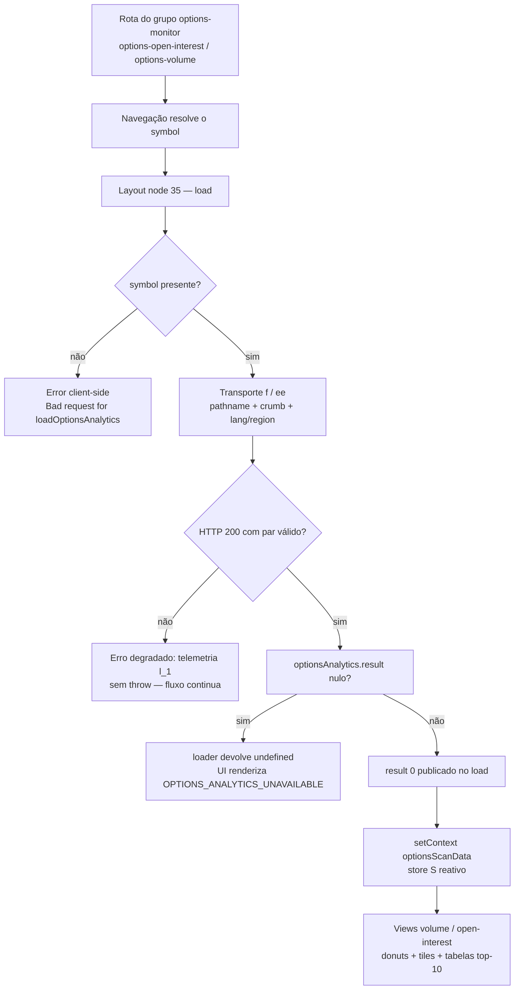

# Engenharia Reversa — Endpoint `GET /v7/finance/options/analytics/{symbol}`

Requisição exige 🔑 `Cookie (A3)` + `Crumb` (§2.3 — emissão no §2.5 e §10.1). Sem esse par, HTTP 401. Método GET; hosts válidos `query1.finance.yahoo.com` / `query2.finance.yahoo.com` / `iquery.finance.yahoo.com`.

---

## 1. Visão geral e papel no aplicativo

O endpoint devolve a camada analítica agregada da cadeia de opções de um ativo: somatórios de volume e de interesse aberto por lado (call/put), as razões put/call correspondentes e três listas "top 10" de contratos — por volume, por interesse aberto e por razão volume/interesse aberto. Não devolve a cadeia em si, nem cotações do subjacente, nem lista de vencimentos: é o complemento analítico consumido pelo Monitor de Opções do site (páginas de interesse aberto e de volume por ativo), que por sua vez usa a cadeia bruta do endpoint irmão `/v7/finance/options/{symbol}` para a visualização por strike.

O consumidor é o grupo de rotas `(options-monitor)` do aplicativo de cotação: um nó de layout compartilhado carrega os dados uma única vez e os publica num contexto Svelte; as duas páginas-folha (`options-open-interest` e `options-volume`) apenas leem esse contexto e escolhem a view correspondente.

| Contexto de Uso | Arquivo Base / Chunk | Identificador / Função Lógica | Como chama |
| :--- | :--- | :--- | :--- |
| Layout do grupo `(options-monitor)` — carregamento das rotas `options-open-interest` e `options-volume` | node de layout do grupo (o índice rotaciona por deploy: 35 no build de out/2026, 43 no de nov/2026) | `loadOptionsAnalytics` (minificado: `j`) | `pathname` + `crumb: true`, sem query própria |
| Contexto Svelte que publica o dado nas páginas-folha | `chunks/[context].[hash].js` | `S = c("optionsScanData", null)` | `setContext(data?.optionsAnalytics ?? null)` |
| Página-folha `options-open-interest` | a folha (re-export do componente `a`) | — | — |
| Página-folha `options-volume` | a folha (re-export do componente `ao`) | — | — |
| UI do monitor: donuts, tiles, tabelas e views | o chunk da UI do monitor (hash rotaciona) | views `"volume"` / `"open-interest"` | `S_1.getContext()` + subscrição reativa |
| Transporte central de fetch | `chunks/[quoteUtil].[hash].js` | `f` (construtor de request: `ee`) | host `query1` do serviceConfig `finance`, `credentials: "include"` |
| Registro de rotas | `entry/[app].[hash].js` | tabela de rotas | `"/(app)/quote/[symbol]/(options-monitor)/options-open-interest": [<folha>, [root, master, monitor]]` — os índices rotacionam por deploy (out/2026: `[182, [2, 31, 35]]`; nov/2026: `[193, [2, 39, 43]]`) — a rota e a estrutura são o contrato |

```js
// node de layout do grupo (options-monitor) — loadOptionsAnalytics (minificado: j), verbatim integral
async function j(n, a) {
  let l;
  const { symbol } = a;                    // symbol vem do resolve da rota
  if (!symbol) {
    const t = new Error("Bad request for loadOptionsAnalytics");
    l_1(n, a, {                            // telemetria de erro degradado
      data: t,
      perfLabel: "loadOptionsAnalytics",
    });
    throw t;                               // guard client-side: nem chega à rede
  }
  try {
    const t = await f(n, {                 // f = transporte central (quoteUtil)
      crumb: true,                         // crumb via query param
      pathname: `/v7/finance/options/analytics/${symbol}`,
      perfLabel: "loadOptionsAnalytics",
    });                                    // SEM query própria: nenhum parâmetro
    if ((l = t?.optionsAnalytics?.result) == null) {
      return undefined;                    // envelope sem result → undefined
    } else {
      return l[0];                          // apenas o primeiro elemento
    }
  } catch (data) {
    l_1(n, a, {                            // erro degradado: loga e engole
      data,
      perfLabel: "loadOptionsAnalytics",
    });
  }
}
```

O `load` do nó de layout é o ponto de entrada, fundindo os resultados num único objeto de dados de página:

```js
// node de layout do grupo (options-monitor) — load do layout, verbatim
const load = async (n) => {
  const { commonActions, commonQuoteActions, symbol } = await i(n);
  return p({
    ...commonActions(),
    ...commonQuoteActions(),
    optionsAnalytics: j(n, { symbol }),    // chave lida pelo componente do layout
  });
};
```

### 1.1 Arquitetura de referência

1. **Camada de Contexto / Estado:** `S` (chunk do contexto — `optionsScanData`) — store Svelte criado com a chave `"optionsScanData"`, publicado via `setContext` no componente do layout e consumido por subscrição reativa nas páginas-folha. Não há persistência em memória entre navegações — nenhum módulo de store de mercado referencia o endpoint, de modo que cada entrada no grupo de rotas dispara nova consulta.
2. **Camada de Loader / Gateway:** `loadOptionsAnalytics` (o node de layout do grupo) — valida a presença do símbolo, monta o `pathname`, marca `crumb: true` e despacha ao transporte; falhas são degradadas (telemetria sem `throw`).
3. **Camada de Transporte / Fetch:** `f` (`chunks/[quoteUtil].[hash].js`) — resolve host do serviceConfig `finance`, injeta `crumb`, `lang` e `region` como defaults de query, mantém `credentials: "include"` e timeout de 15 s.
4. **Camada de Apresentação / Consumidor:** o chunk da UI do monitor — componente único com duas views (`"volume"` e `"open-interest"`); tiles com donut de razão put/call, tabelas `DataTablev2` com colunas por métrica e fallback de indisponibilidade quando o contexto vem vazio.

### 1.2 Ciclo de vida



### 1.3 Otimizações do loader

- **Sem cache em memória:** o loader não consulta nenhum store antes de despachar — o dado vive apenas no contexto Svelte da árvore renderizada. A reentrada na rota refaz a consulta; a proteção contra repetição é a cache curta da edge (ver §8.5).
- **Guard de entrada pré-rede:** símbolo ausente levanta `Error("Bad request for loadOptionsAnalytics")` antes de qualquer requisição — o erro client-side nunca chega ao servidor.
- **Modo silencioso / tratamento gracioso:** exceções do fetch e envelopes sem `result` são degradados a `undefined` com registro em telemetria (`l_1`), sem propagar o erro para as páginas-folha; a UI substitui por mensagem de indisponibilidade (`OPTIONS_ANALYTICS_UNAVAILABLE`).
- **Extração mínima:** o loader consome apenas `result[0]` — o resto do envelope é descartado no cliente, ainda que o servidor não ofereça parâmetro de projeção para reduzir o payload (ver §5.0).

---

## 2. Especificação do Protocolo Wire (Request)

### 2.1 Linha de requisição

```http
GET /v7/finance/options/analytics/AAPL?crumb=<crumb>&lang=en-US&region=US HTTP/2
Host: query1.finance.yahoo.com
```

O path carrega o único parâmetro de seleção (o símbolo); a query carrega apenas credencial e locale — os três defaults injetados pelo transporte. O cliente oficial não envia nenhum outro parâmetro.

### 2.2 Hosts válidos

| Host | Papel | Evidência no Bundle |
| :--- | :--- | :--- |
| `https://query1.finance.yahoo.com` | Produção principal — host default do serviceConfig `finance` no transporte | `chunks/[quoteUtil].[hash].js` |
| `https://query2.finance.yahoo.com` | Espelho geo-DNS — responde `200` com payload equivalente | verificado ao vivo |
| `https://iquery.finance.yahoo.com` | Rota interna — acessível ao par A3+crumb, `200` com payload equivalente | verificado ao vivo |

### 2.3 Cabeçalhos críticos da requisição

| Header | Valor exigido / recomendado | Efeito de ausência / erro |
| :--- | :--- | :--- |
| `User-Agent` | Perfil de browser recente | UA de biblioteca (`python-requests`) → HTTP 429 na edge, 23 bytes de texto puro |
| `Accept` | `*/*` ou `application/json` | Ambos aceitos no endpoint de dados |
| `Cookie` | `A3=<token_a3_sessao>` | HTTP 401 `Unauthorized` / `Invalid Crumb` |
| `crumb` (query) ou `x-crumb` (header) | `<token_crumb>` casado com o cookie | HTTP 401 `Unauthorized` / `Invalid Crumb` |
| `Origin` | `https://finance.yahoo.com` | Com origem confiável, a resposta reflete `Access-Control-Allow-Origin` + `Access-Control-Allow-Credentials: true`; origem não confiável recebe resposta sem ACAO (ver §8.4) |
| `Referer` | `https://finance.yahoo.com/` | Telemetria/anti-bot; sem efeito observado no contrato |

> **Nota sobre vetor do Crumb:** o transporte do app envia o crumb como query param em requisições GET; o header `x-crumb` é reservado para métodos não-GET pelo cliente oficial. O servidor aceita ambos os vetores isoladamente — `x-crumb` sozinho responde `200` — e, quando ambos estão presentes e divergem, o query param prevalece (header garbage + query válido → `200`; o inverso não ocorre porque o query é o validado). Sem cookie, com cookie sem crumb, com crumb sem cookie ou com crumb garbage: todas as quatro combinações desemparelhadas devolvem o mesmo `401` com corpo `{"finance":{"result":null,"error":{"code":"Unauthorized","description":"Invalid Crumb"}}}`. A emissão e o ciclo de vida do par não são reexplicados aqui (ver relatório dedicado de autenticação).

### 2.4 Timeouts do cliente oficial

| Medição | Valor | Fonte |
| :--- | :---: | :--- |
| Timeout padrão REST | `15 000 ms` | `chunks/[quoteUtil].[hash].js` (`k = 15000`) |
| Tempo de upstream observado (200 com dados) | `12–14 ms` | header `x-envoy-upstream-service-time` |
| Tempo de upstream observado (401/404/405) | `1 ms` | idem — rejeitado cedo no serviço |
| Cache TTL HTTP (edge) | `max-age=1` + `stale-while-revalidate=9` | header `cache-control` (ver §8.5) |

### 2.5 Exemplo de requisição completa

```bash
# 1. Capturar o Cookie A3 de sessão inicial
#    (fc.yahoo.com devolve 404 SEM redirect — esperado; o Set-Cookie A3 é o payload)
curl -s -c cookies.txt "https://fc.yahoo.com" > /dev/null

# 2. Emitir o token Crumb casado com o cookie de sessão
#    (getcrumb rejeita Accept: application/json com 406 — usar */*)
CRUMB=$(curl -s -b cookies.txt \
  -H "User-Agent: Mozilla/5.0 (Windows NT 10.0; Win64; x64) AppleWebKit/537.36 (KHTML, like Gecko) Chrome/131.0.0.0 Safari/537.36" \
  -H "Accept: */*" \
  -H "Referer: https://finance.yahoo.com/" \
  "https://query1.finance.yahoo.com/v1/test/getcrumb")

# 3. Executar a consulta com o par casado (Cookie + Crumb)
#    — sem cookie, o curl abaixo devolve 401 Invalid Crumb
curl -s -b cookies.txt \
  -H "User-Agent: Mozilla/5.0 (Windows NT 10.0; Win64; x64) AppleWebKit/537.36 (KHTML, like Gecko) Chrome/131.0.0.0 Safari/537.36" \
  -H "Accept: application/json" \
  -H "Origin: https://finance.yahoo.com" \
  "https://query1.finance.yahoo.com/v7/finance/options/analytics/AAPL?crumb=${CRUMB}&lang=en-US&region=US"
```

---

## 3. Parâmetros de Query

| Parâmetro | Tipo | Obrigatório | Padrão | Depende de Feature Flag? | Comportamento e Casos de Borda |
| :--- | :---: | :---: | :---: | :---: | :--- |
| `{symbol}` (path) | string | **Sim** | — | Não | Ativo com cadeia de opções listada. Normalizado para caixa alta no `underlyingSymbol` da resposta (`aapl` → `AAPL`). Sem validação de formato observada: espaço, `%`, hífen e vírgula são aceitos como parte do símbolo; strings de 300 e de 2000 caracteres devolvem `200` com o símbolo integral ecoado. Índices (`^GSPC`, percent-encoded `%5E`), cripto, câmbio, ações sem cadeia no feed e símbolos inexistentes devolvem a forma zerada (ver §4.4). |
| `crumb` | string | **Sim 🔑** | — | Não | Token CSRF casado com o cookie `A3`. Vetor duplo: query param ou header `x-crumb`; em divergência, o query prevalece (§2.3). |
| `lang` | string | Não | `en-US` | Não | Injetado pelo transporte como default. Sem efeito no corpo: a comparação campo a campo entre `en-US`/`US` e `pt-BR`/`BR` devolve as três listas de contratos idênticas (símbolo a símbolo) — a resposta não contém strings localizáveis. |
| `region` | string | Não | `US` | Não | Injetado pelo transporte como default. Sem efeito observado no corpo. |

**Parâmetros no-op (aceitos porém ignorados)** — comprovados por comparação de corpo (listas de contratos idênticas símbolo a símbolo contra a canônica, campos voláteis à parte):

| Parâmetro | Veredito |
| :--- | :--- |
| `formatted` (`true`/`false`) | No-op — o endpoint não possui envelope `{raw, fmt}` (§4.3) |
| `date` | No-op — não filtra vencimento; ecoar epoch não altera as listas |
| `straddle` | No-op — bandeira do endpoint irmão da cadeia |
| `getAllData` | No-op — bandeira do endpoint irmão da cadeia |
| `strikeMin` / `strikeMax` | No-op — filtro de strike do endpoint irmão da cadeia |
| qualquer parâmetro desconhecido | No-op — descartado silenciosamente |

> **Convenção de codificação:** símbolos compostos exigem URL Encoding estrito no path — `^` → `%5E`, `=` → `%3D`. Não há lote: `AAPL,MSFT` é tratado como um único símbolo (devolve a forma zerada ecoando a string com vírgula). O path sem o segmento do símbolo não devolve erro do endpoint: a rota-irmã da cadeia captura a requisição (ver §4.2).

---

## 4. Estrutura da Resposta

### 4.1 Envelope de sucesso

```json
{
  "optionsAnalytics": {
    "result": [
      {
        "underlyingSymbol": "AAPL",
        "volumeSummary": {
          "putCallVolumeRatio": 0.4191759036606279,
          "callVolume": 208762,
          "putVolume": 87508,
          "totalVolume": 296270,
          "lastUpdatedVolumeTimestamp": 1790962486
        },
        "openInterestSummary": {
          "putCallOiRatio": 0.7308049895677007,
          "callOpenInterest": 2854596,
          "putOpenInterest": 2086153,
          "totalOpenInterest": 4940749
        },
        "topVolumeContracts": [ { "...": "..." } ],
        "topOpenInterestContracts": [ { "...": "..." } ],
        "topVolumeOpenInterestRatioContracts": [ { "...": "..." } ]
      }
    ],
    "error": null
  }
}
```

Formato do `result`: array com exatamente um objeto por símbolo consultado (o loader consome `result[0]`). O objeto tem exatamente seis chaves — não há `quote` do subjacente, não há `expirationDates`, não há `hasMiniOptions`. O catálogo completo está na §5.

Cada lista `top*Contracts` traz até dez contratos, em ordem decrescente da métrica que a nomeia, misturando calls e puts e vencimentos distintos (incluindo LEAPS de longo prazo na lista de razão volume/OI). O contrato tem os mesmos quinze campos do irmão da cadeia mais um campo exclusivo (`volumeOiRatio` — §5.4).

### 4.2 Envelope de erro

```json
{
  "finance": {
    "result": null,
    "error": {
      "code": "Unauthorized",
      "description": "Invalid Crumb"
    }
  }
}
```

O envelope troca de `optionsAnalytics` para `finance` nas falhas de autenticação (`401`) e de protocolo (`405`; rota inexistente `404`). Há duas exceções de forma:

- **429 da edge:** corpo em texto puro (`Edge: Too Many Requests`, 23 bytes, sem envelope) — tanto por rate limit quanto pelo WAF de path traversal (sequência `..%2F..%2F` no lugar do símbolo; ver §7).
- **Path sem símbolo:** `GET /v7/finance/options/analytics` (com ou sem barra final) devolve `200` com o envelope da rota-irmã — `{"optionChain":{"result":[],"error":null}}`. O roteador do backend casa o path vazio contra `/v7/finance/options/{symbol}` com `{symbol}` = `analytics`, que é um "símbolo" sem cadeia; a resposta, portanto, vem do endpoint da cadeia, não deste. Reimplementações devem tratar esse caso como requisição malformada antes de sair à rede (o cliente oficial faz exatamente isso com o guard client-side do loader).

### 4.3 Regras `formatted=false` vs `formatted=true`

O endpoint não aceita `formatted`; todos os valores são devolvidos como primitivos. Não existe envelope `{raw, fmt, longFmt}` em nenhuma condição — o parâmetro é aceito e ignorado (§3).

### 4.4 Variantes suportadas

| Dimensão | Valores Observados | Efeito na Resposta |
| :--- | :--- | :--- |
| Ativo com cadeia | `AAPL`, `NVDA`, `TSLA`, `SPY` (ETF), `BRK-B` (classe com hífen) | `result[0]` com summaries populados e listas de 10 contratos |
| Ativo sem cadeia no feed | `^GSPC`, `BTC-USD`, `EURUSD=X`, `PETR4.SA`, `NAOEXISTE123`, `AAPL,MSFT`, strings longas | `result[0]` na forma zerada: símbolo ecoado, razões `0.0`, contadores `0`, `lastUpdatedVolumeTimestamp: 0`, três listas vazias |
| `marketState` do subjacente | qualquer | Sem efeito estrutural — o endpoint não carrega campo de estado de mercado |

A forma zerada é omissão silenciosa com forma cheia: `200`, `error: null`, `result` com um objeto — não `result: []`, não `404`. O loader oficial traduz isso para `undefined` só quando `result` é nulo; a forma zerada segue para a UI, que renderiza zeros e listas vazias.

---

## 5. Catálogo de Campos e Módulos

**Legenda de disponibilidade:**
- **T** = presente por padrão no retorno base.
- **—** = não retornado.

**Tipos:** `num` = number, `int` = inteiro, `str` = string, `bool` = booleano, `list` = array, `nested` = objeto aninhado. Todos os valores são primitivos (§4.3).

### 5.0 Mecanismo de controle de projeção

Não há parâmetro seletor: a resposta é fixa — seis chaves no `result[0]`, sempre as mesmas, para qualquer símbolo. Não existe `fields=`, `modules=` ou equivalente; o volume do payload é função apenas da liquidez do ativo (número de contratos nas listas top).

### 5.1 Campos de `optionsAnalytics.result[0]`

| Campo | Disp. | Tipo | Descrição Funcional | Exemplo Real |
| :--- | :---: | :---: | :--- | :--- |
| `underlyingSymbol` | T | `str` | Símbolo do subjacente, normalizado para caixa alta | `"AAPL"` |
| `volumeSummary` | T | `nested` | Somatórios do dia para o volume de contratos (§5.2) | — |
| `openInterestSummary` | T | `nested` | Somatórios de interesse aberto (§5.3) | — |
| `topVolumeContracts` | T | `list` | Dez contratos com maior `volume` | — |
| `topOpenInterestContracts` | T | `list` | Dez contratos com maior `openInterest` | — |
| `topVolumeOpenInterestRatioContracts` | T | `list` | Dez contratos com maior `volumeOiRatio` | — |

### 5.2 Campos de `volumeSummary`

| Campo | Disp. | Tipo | Descrição Funcional | Exemplo Real |
| :--- | :---: | :---: | :--- | :--- |
| `callVolume` | T | `int` | Volume acumulado do dia em calls | `208762` |
| `putVolume` | T | `int` | Volume acumulado do dia em puts | `87508` |
| `totalVolume` | T | `int` | `callVolume + putVolume` | `296270` |
| `putCallVolumeRatio` | T | `num` | `putVolume / callVolume` | `0.4191759036606279` |
| `lastUpdatedVolumeTimestamp` | T | `int` | Epoch (segundos) da última atualização do snapshot volumétrico | `1790962486` |

> O bloco de volume vem de um snapshot loteado, distinto do fluxo em tempo real da cadeia (ver §8.3) — a UI exibe aviso de dado retardado na view de volume. `lastUpdatedVolumeTimestamp` anda com o instante da requisição, mas os agregados por trás dele avançam em lotes (medido: +40 contratos no `totalVolume` ao longo de 230 s de pregão aberto).

### 5.3 Campos de `openInterestSummary`

| Campo | Disp. | Tipo | Descrição Funcional | Exemplo Real |
| :--- | :---: | :---: | :--- | :--- |
| `callOpenInterest` | T | `int` | Interesse aberto total em calls (cadeia completa) | `2854596` |
| `putOpenInterest` | T | `int` | Interesse aberto total em puts | `2086153` |
| `totalOpenInterest` | T | `int` | `callOpenInterest + putOpenInterest` | `4940749` |
| `putCallOiRatio` | T | `num` | `putOpenInterest / callOpenInterest` | `0.7308049895677007` |

### 5.4 Catálogo dos 16 campos do contrato (`topVolumeContracts[]` / `topOpenInterestContracts[]` / `topVolumeOpenInterestRatioContracts[]`)

Os três arrays usam o mesmo formato de item.

| Campo | Disp. | Tipo | Descrição Funcional | Exemplo Real |
| :--- | :---: | :---: | :--- | :--- |
| `contractSymbol` | T | `str` | Símbolo OCC do contrato (`AAPL261005C00335000` — raiz, yymmdd, tipo `C`/`P` na 9ª casa a partir do fim, strike ×1000 em 8 dígitos) | `"AAPL261005C00335000"` |
| `strike` | T | `num` | Strike de exercício | `335.0` |
| `currency` | T | `str` | Moeda de negociação do contrato | `"USD"` |
| `lastPrice` | T | `num` | Último negócio do contrato | `1.27` |
| `change` | T | `num` | Variação absoluta do preço | `0.14999998` |
| `percentChange` | T | `num` | Variação percentual em unidades de % (`13.392856` = 13,39%) | `13.392856` |
| `volume` | T | `int` | Volume do dia do contrato | `26501` |
| `openInterest` | T | `int` | Interesse aberto do contrato | `2851` |
| `bid` | T | `num` | Melhor compra | `1.2` |
| `ask` | T | `num` | Melhor venda | `1.29` |
| `contractSize` | T | `str` | Porte do contrato | `"REGULAR"` |
| `expiration` | T | `int` | Epoch (segundos) do vencimento | `1791158400` |
| `lastTradeDate` | T | `int` | Epoch (segundos) do último negócio | `1790962393` |
| `impliedVolatility` | T | `num` | Volatilidade implícita em fração decimal (`0.1438` = 14,38%) | `0.14380739013671873` |
| `inTheMoney` | T | `bool` | Dentro do dinheiro na view do subjacente | `false` |
| `volumeOiRatio` | T | `num` | `volume / openInterest` — campo exclusivo desta família (o endpoint da cadeia não o devolve) | `9.2953349701859` |

### 5.5 Campos que o cliente não lê

| Campo | Veredito | Comportamento Real |
| :--- | :--- | :--- |
| `totalVolume`, `totalOpenInterest`, `lastUpdatedVolumeTimestamp` | Não lidos pelo bundle | Os tiles da UI derivam os totais dos valores por lado; os somatórios e o carimbo de tempo do snapshot ficam disponíveis apenas para consumidores diretos da API |
| `currency`, `bid`, `ask`, `contractSize`, `expiration`, `lastTradeDate`, `inTheMoney` | Não lidos pelo bundle | A tabela do monitor exibe apenas símbolo, último, variação, variação %, volume, OI, V/OI e IV; o deep-link do contrato é montado a partir de `contractSymbol` |
| `underlyingSymbol` | Não lido pelo bundle | A UI recebe o símbolo da rota; o eco serve de validação para reimplementações |

### 5.6 Invariantes aritméticos

Verificados sobre as trinta posições de contratos de uma mesma resposta e sobre os dois summaries:

1. `callVolume + putVolume == totalVolume`
2. `callOpenInterest + putOpenInterest == totalOpenInterest`
3. `putCallVolumeRatio == putVolume / callVolume`
4. `putCallOiRatio == putOpenInterest / callOpenInterest`
5. `volumeOiRatio == volume / openInterest` (por contrato, exato na amostra de 30/30)

---

## 6. Matriz de presença por classe de ativo

Legenda: `✅` = presente na resposta para a classe; `—` = ausente/irrelevante.

| Campo / Bloco | Ação Comum (`EQUITY`) | ETF (`SPY`) | Índice (`^GSPC`) | Cripto (`BTC-USD`) | Câmbio (`EURUSD=X`) | Ação BR (`PETR4.SA`) | Símbolo inexistente |
| :--- | :---: | :---: | :---: | :---: | :---: | :---: | :---: |
| `underlyingSymbol` (eco) | ✅ | ✅ | ✅ | ✅ | ✅ | ✅ | ✅ |
| `volumeSummary` populado | ✅ | ✅ | — | — | — | — | — |
| `openInterestSummary` populado | ✅ | ✅ | — | — | — | — | — |
| `top*Contracts` com 10 itens | ✅ | ✅ | — | — | — | — | — |
| Listas vazias + zeros | — | — | ✅ | ✅ | ✅ | ✅ | ✅ |

A coluna "Símbolo inexistente" e as classes sem cadeia no feed devolvem sempre `200` com a forma zerada (§4.4) — o eco do símbolo é a única informação presente. A presença de dados depende de o ativo ter cadeia de opções listada no feed que abastece o endpoint, não da classe em si: ações americanas com opções e o ETF SPY respondem com dados; a ação brasileira `PETR4.SA`, sem cadeia no feed, responde zerada.

---

## 7. Erros e códigos de status

Erros de autenticação e protocolo usam o envelope JSON `finance`; o 429 da edge devolve texto puro. Nenhum `400` de validação de parâmetro foi observado — o endpoint não possui parâmetros tipados além do símbolo, que aceita qualquer string.

| HTTP | `code` | `description` | Causa |
| :---: | :--- | :--- | :--- |
| `401` | `Unauthorized` | `Invalid Crumb` | Par A3+crumb ausente ou desemparelhado — as quatro variantes (sem cookie e sem crumb, crumb sem cookie, cookie sem crumb, crumb garbage com cookie válido) devolvem o mesmo corpo de 89 bytes. Envelope `finance`. |
| `404` | `Not Found` | `HTTP 404 Not Found` | Rota/subpath inexistente (ex.: `..` no lugar do símbolo, após normalização do path). Envelope `finance`. Não confundir com símbolo inexistente, que devolve `200` zerado. |
| `405` | `Method Not Allowed` | `HTTP 405 Method Not Allowed` | POST/PUT no endpoint GET-only. Envelope `finance`; resposta sem header `Allow`. |
| `429` | — (texto puro, sem envelope) | `Edge: Too Many Requests` | Rate limit da edge — ou WAF de path traversal: `..%2F..%2F` no lugar do símbolo devolve 429 de 23 bytes mesmo com UA de navegador e volume baixo, enquanto o path normal responde `200` no mesmo instante. |
| `200` | — | — | Omissão silenciosa: ativo sem cadeia devolve a forma zerada com `error: null` (§4.4). |
| `200` (envelope trocado) | — | — | Path sem o segmento do símbolo capturado pela rota-irmã da cadeia: corpo `{"optionChain":{"result":[],"error":null}}` (§4.2). |

---

## 8. Comportamentos empíricos

### 8.1 Requisitos de borda, WAF e anti-bot

- **Inspeção de User-Agent:** a edge rejeita UA de biblioteca (`python-requests/2.31.0`) com `429` de 23 bytes, texto puro `Edge: Too Many Requests` — mesmo com cookie e crumb válidos na requisição. UA de navegador com fingerprint TLS padrão de biblioteca passa sem bloqueio (a implementação de referência em stdlib pura atesta).
- **WAF de path traversal:** sequência `..%2F` encodada no segmento do símbolo dispara `429` da edge — assinatura idêntica ao rate limit, distinguível enviando o path normal no mesmo instante (`200`).
- **Headers de borda na resposta 200:** `server: ATS`, `vary: Origin,Accept-Encoding`, `y-rid` presente, `x-envoy-decorator-operation: finance-quote-api--mtls-production-sg3.finance-k8s:4080/*`, `x-envoy-upstream-service-time` entre 12–14 ms para respostas com dados e 1 ms nas rejeições — o upstream é o mesmo serviço `finance-quote-api` da família da cadeia de opções.
- **HEAD:** responde `200` com `Content-Length: 0` (o corpo é suprimido, não calculado).

### 8.2 Comportamentos silenciosos

- **Parâmetros no-op:** `formatted`, `date`, `straddle`, `getAllData`, `strikeMin`/`strikeMax` e quaisquer desconhecidos são aceitos e ignorados — a comparação das três listas de contratos contra a canônica é idêntica símbolo a símbolo (§3).
- **Locale sem efeito:** `pt-BR`/`BR` devolve o mesmo conteúdo de `en-US`/`US` (a resposta não contém strings formatáveis).
- **Normalização de case:** `aapl` devolve `underlyingSymbol: "AAPL"` com dados completos.
- **Sem lote:** `AAPL,MSFT` é um único símbolo inexistente (forma zerada ecoando a string com vírgula).
- **Sem limite de comprimento:** símbolos de 300 e de 2000 caracteres devolvem `200` zerado com o símbolo integral ecoado — o corpo cresce com o eco (2.392 bytes para 2.000 caracteres), sem `414` nem `400`.
- **Sem validação de caracteres:** espaço (`AA PL`) e `%` duplo (`AA%25PL`) são aceitos como símbolo e ecoados zerados; hífen é parte legítima de símbolo de classe (`BRK-B` devolve dados).
- **Envelope trocado por captura de rota:** path sem símbolo responde pela rota-irmã da cadeia com `{"optionChain":...}` (§4.2) — o único cenário em que este endpoint devolve envelope que não é `optionsAnalytics` nem `finance`.

### 8.3 Semântica de agregação dos somatórios

O contrato dos blocos de sumário não é "soma da cadeia em tempo real" — as duas metades têm fontes distintas, comprovadas por confronto direto contra o endpoint irmão com `getAllData=true` (cadeia completa, 22 vencimentos, 2.627 contratos, zero duplicatas):

- **`totalOpenInterest` é a soma exata da cadeia completa:** confere centena a centena com a soma de `openInterest` de todos os contratos de todos os vencimentos, incluindo o vencimento do dia (delta zero, medido em duas ocasiões com quatro minutos de intervalo, sem alteração). Reimplementações podem validar contra o irmão da cadeia com `getAllData=true`.
- **`totalVolume` não é a soma da cadeia em tempo real:** a soma da cadeia completa ficou 73% acima do total do analytics no mesmo instante; descontando o vencimento do dia (0DTE, dominante no volume intradiário), a soma ainda ficou 11,1% acima. O bloco de volume vem de um snapshot loteado e retardado — coerente com o aviso de dado retardado que a UI renderiza na view de volume — enquanto os valores por contrato das listas top conferem com a cadeia servida no mesmo minuto (comprovação no parágrafo seguinte).
- **Listas top conferem com a cadeia, valor a valor:** para os dez contratos de `topVolumeContracts`, os campos `volume`, `openInterest`, `lastPrice`, `bid` e `ask` são idênticos aos devolvidos pelo irmão da cadeia no mesmo instante (10/10); e o top-10 de volume do analytics coincide, em símbolos e na ordem, com o top-10 de volume recomputado da cadeia completa **excluindo o vencimento do dia** (9/10 na interseção, com a divergência restante atribuível ao atraso do snapshot).
- **Contratos do vencimento do dia não aparecem nas listas top:** as trinta posições observadas cobrem oito vencimentos distintos — incluindo LEAPS a dois anos — e nenhuma contém contrato do vencimento do dia, ainda que esses contratos dominem o volume intradiário da cadeia (7 das 10 maiores posições de volume no recomputado completo). As listas top do analytics enxergam a cadeia a partir do próximo vencimento.
- **`impliedVolatility` de lote:** o IV dos contratos difere do IV do mesmo contrato no irmão da cadeia em 9 de 10 posições, com desvio absoluto entre 0,00003 e 0,00100 (ex.: `0.14112` no analytics contra `0.14149` na cadeia) — duas casas de precisão, modelo/snapshot distintos; os preços e o livro, não.
- **Deriva lenta do snapshot:** em duas amostras separadas por 230 s de pregão aberto, o `totalVolume` avançou 40 contratos — ordens de grandeza abaixo do ritmo da cadeia em tempo real no mesmo período; `lastUpdatedVolumeTimestamp` acompanha o instante da requisição nas duas amostras.
- **Ranking da razão V/OI:** a lista é ordenada pela razão do snapshot (não pela razão recomputada da cadeia em tempo real), de modo que contratos com volume defasado no lote podem figurar fora da posição que a cadeia corrente sugere.

### 8.4 CORS

- Preflight `OPTIONS` com `Origin: https://finance.yahoo.com`: `200`, `Access-Control-Allow-Origin: https://finance.yahoo.com` (origem específica, nunca `*`), `Access-Control-Allow-Methods: GET, POST, PUT, DELETE, HEAD, OPTIONS`.
- Preflight com origem não confiável (`https://evil.example.com`): `200` **sem** `Access-Control-Allow-Origin` — o navegador bloqueia a leitura.
- GET real com `Origin` confiável: a resposta reflete a origem em `Access-Control-Allow-Origin` e envia `Access-Control-Allow-Credentials: true` (o app trafega cookies via `credentials: "include"`). GET sem header `Origin`: resposta sem ACAO (não é resposta CORS).
- Decisão de CORS tomada na edge, antes do upstream — respostas com e sem ACAO chegam com o mesmo tempo de upstream.

### 8.5 Cache

| Header de Cache | Valor Observado | Observação |
| :--- | :--- | :--- |
| `cache-control` (200) | `public, max-age=1, stale-while-revalidate=9` | Mesmo bucket da família da cadeia; `age: 2` observado em re-consulta |
| `cache-control` (401/404/405) | `max-age=0, private` | Erros não são cacheados |
| `etag` | ausente | Sem `If-None-Match`/304 — revalidação por idade apenas |
| `content-type` | `application/json;charset=utf-8` | Corpo em uma linha, sem formatação |

### 8.6 Relógio e unidades

- **Epoch em segundos** para os três carimbos de tempo do payload: `lastUpdatedVolumeTimestamp`, `expiration` e `lastTradeDate`. A forma zerada usa `0` como sentinela (sem snapshot, sem vencimento, sem negócio).
- **Razões em fração decimal:** `putCallVolumeRatio` e `putCallOiRatio` são razões put/call cruas (`0.4192` = 42 puts para cada 100 calls); a UI multiplica por 100 para exibir percentual.
- **`percentChange` em unidades de %** (`13.392856` = 13,39%) — o `fmt` da cadeia espelha o `raw`.
- **`impliedVolatility` em fração decimal** (`0.1438` = 14,38%).
- **`volumeOiRatio` sem unidade** (contratos por contrato de interesse aberto).

---

## 9. Referências do código-fonte (bundle)

### 9.1 Quem chama o endpoint e de onde vem o comportamento

| Arquivo | Imports | Papel / padrão de chamada |
| :--- | :--- | :--- |
| O node de layout do grupo `(options-monitor)` | transporte, contexto, telemetria | `loadOptionsAnalytics` — o único chamador do endpoint; validação de símbolo, `pathname` com interpolação, `crumb: true`, extração de `result[0]`, erro degradado |
| `chunks/[quoteUtil].[hash].js` | serviceConfig da sessão | `f`/`ee` — construtor de request: host, defaults de query, injeção do crumb, timeout 15 s |
| O chunk da UI do monitor | contexto, telemetria, transporte | UI do monitor — consome o contexto `optionsScanData` por subscrição reativa |
| `entry/[app].[hash].js` | manifesto lazy de nós | Registra o node de layout no array de nós e o vincula às rotas do grupo `(options-monitor)` |
| `chunks/[money].[hash].js` | — | Verificação negativa: nenhum store de mercado referencia `optionsAnalytics` — o loader da cadeia tem store própria aqui; o do analytics não |

### 9.2 Camada de serviço compartilhada

O endpoint usa o transporte central compartilhado com toda a família de dados de cotação — não há builder próprio. Trecho integral da montagem da requisição (nomes restaurados entre colchetes):

```js
// chunks/[quoteUtil].[hash].js — ee (construtor do request), verbatim essencial
const s = await e.parent();
const { session, stores } = s;
const i = stores.crumb.getCrumb();                    // [crumb da sessão]
const o = s.serviceConfig ?? stores.config.getState()?.services;
const u = o?.[t.key || "finance"] ?? {
  host: "query1.finance.yahoo.com",                  // [default do serviceConfig]
  serverKey: "finance",
  client: { timeout: k },                            // [k = 15000 ms]
};
const f = {
  crumb: t.crumb ?? false,                           // [true no analytics]
  host: undefined,
  isRelative: t.isRelative ?? false,
  pathname: t.pathname,                              // [/v7/finance/options/analytics/{symbol}]
  perfLabel: t.perfLabel || t.pathname,
  protocol: t.protocol || "",
  query: t.query,                                    // [ausente no analytics]
};
if (!f.isRelative) {
  f.host = u.host;                                   // [query1]
}
const y = Ie(c ? f : Le(f, { serverKey: u?.serverKey }));
if (!t.disableDefaultQueries) {                      // [ausente no analytics → aplica]
  y.searchParams.set("lang", session.lang || "en-US");
  y.searchParams.set("region", session.region || "US");
}
if (f.crumb && i) {
  y.searchParams.set("crumb", i);                    // [vetor query no GET]
  if (l.method !== "GET" && l.method !== "HEAD" && l.method !== "OPTIONS") {
    l.headers["x-crumb"] = i;                        // [header só em não-GET]
  }
}
```

`disableDefaultQueries` ausente no loader do analytics — `lang` e `region` entram sempre; `query` ausente — nenhum outro parâmetro é acrescentado pelo cliente.

### 9.3 Fluxo de credenciais no cliente

1. O loader marca `crumb: true` na chamada ao transporte.
2. O transporte lê o token de `stores.crumb.getCrumb()` e o anexa como query param.
3. O cookie `A3` acompanha nativamente via `credentials: "include"` do `fetch`.

### 9.4 Hosts e serialização

O host sai do serviceConfig da sessão (`finance` → `query1.finance.yahoo.com`); não há serializador de parâmetros próprio porque a query é fixa (crumb + locale). O modo SSR reescreve a URL para `/xhr/service` com `x-key: finance` — irrelevante para clientes diretos.

### 9.5 Mapa resumido da cadeia

```
entry/[start].[hash].js
  └── entry/[app].[hash].js — array de nós + tabela de rotas
        ├── "/(app)/quote/[symbol]/(options-monitor)/options-open-interest" → [<folha>, [root, master, monitor]]
        ├── "/(app)/quote/[symbol]/(options-monitor)/options-volume"        → [<folha>, [root, master, monitor]]
        │        layout = o node de layout do grupo (índices rotacionam por deploy)
        │          ├── load → loadOptionsAnalytics (j)
        │          │         └── f/ee (chunks/[quoteUtil]) → GET /v7/finance/options/analytics/{symbol}
        │          └── component → setContext("optionsScanData")
        │                 └── S (chunks/[context].[hash].js) — store do contexto
        ├── a folha options-open-interest → componente do chunk da UI do monitor
        └── a folha options-volume        → componente `ao`
                └── views "volume" / "open-interest" (chunk da UI do monitor)
                        ├── tiles com donut de razão put/call
                        ├── tabelas DataTablev2 (top-10 por métrica)
                        └── fallback OPTIONS_ANALYTICS_UNAVAILABLE
```

### 9.6 Contrato do consumidor final

| Consumidor | Tipo | Atributos / Props | Fonte |
| :--- | :--- | :--- | :--- |
| Contexto `optionsScanData` | Store Svelte (`c("optionsScanData", null)`) | valor: `result[0]` do envelope ou `null` | `chunks/[context].[hash].js` |
| Componente do monitor | Componente Svelte | `view`: `"volume"` \| `"open-interest"` | o chunk da UI do monitor (hash rotaciona) |
| Tile de razão | Componente Svelte | `ratio`, `callValue`, `putValue`, `ratioLabel`, `callLabel`, `putLabel` | idem |
| Tabela top-10 | Componente Svelte (DataTablev2) | `contracts`, `metric` (`volume`/`openInterest`/`volumeOiRatio`), `label`, `defaultSort` | idem |
| Donut de percentual | Componente Svelte | `percent`, `variant` (`positive`/`negative`), `centerText` | idem |
| Aviso de dado retardado | Componente Svelte | — (renderizado na view de volume) | `chunks/[OptionsDelayedDataNotice].[hash].js` |

A UI lê dos summaries apenas `putCallOiRatio`, `callOpenInterest`, `putOpenInterest`, `putCallVolumeRatio`, `callVolume`, `putVolume` (§5.5); o lado C/P de cada contrato é derivado do próprio `contractSymbol` (9ª casa a partir do fim), e o identificador de linha da tabela combina raiz do símbolo (menos os 15 caracteres finais), strike arredondado a duas casas e a flag C/P.

---

## 10. Guia de reimplementação

### 10.1 Algoritmo

```
1. Iniciar CookieJar (gerenciador de sessão HTTP).
2. GET https://fc.yahoo.com para colher o Cookie A3 (404 esperado — o Set-Cookie é o payload).
3. GET https://query1.finance.yahoo.com/v1/test/getcrumb (Accept: */*) usando o cookie.
4. Armazenar o Crumb.
5. Montar GET /v7/finance/options/analytics/{symbol}?crumb=<crumb>&lang=en-US&region=US
   — symbol percent-encoded na convenção strict (^ → %5E, = → %3D);
   — sem nenhum outro parâmetro (todos os demais são no-op).
6. Executar com timeout de 15 s.
7. HTTP 401 → limpar par, re-executar passos 2–4 uma única vez e repetir o GET.
8. HTTP 429/503 → backoff exponencial (base 2 s, máx. 5 tentativas).
9. Validar o envelope: a chave raiz deve ser optionsAnalytics — corpo com
   chave optionChain indica path sem símbolo (bug do cliente), refazer com o symbol.
10. Consumir result[0] com guards de opcionalidade (§10.2).
```

### 10.2 Regras de parsing indispensáveis

1. **Sem unwrap:** não existe envelope `{raw, fmt}` — todo valor já é primitivo; qualquer código de desembrulhar deve ser condicional e inerte aqui.
2. **Guard por lista:** as três listas `top*Contracts` podem vir vazias (ativo sem cadeia) — iterar somente se presentes, nunca assumir dez itens.
3. **Zeroed ≠ vazio:** a forma zerada (`result[0]` com zeros e eco do símbolo) é a resposta normal de ativo sem opções; `result: []` não ocorre neste endpoint; `result: null` com `error` preenchido pertence ao envelope `finance` de falha.
4. **Envelope trocado:** corpo com `optionChain` na raiz significa que a requisição perdeu o símbolo do path e caiu na rota-irmã — tratar como erro do cliente, não como dados.
5. **Percentual:** `percentChange` em unidades de %; `putCall*Ratio` e `impliedVolatility` em fração — não multiplicar/cortar antes de validar a unidade.
6. **Epoch em segundos** nos três carimbos; `0` é sentinela, não data.
7. **Par atômico:** renovar cookie e crumb juntos (§2.3); nunca misturar sessões concorrentes no mesmo cliente.
8. **Cache local:** respeitar `max-age=1` — para uso interativo, cache própria de 1–10 s é suficiente e evita 429.

### 10.3 Implementação de referência

O código executável completo reside no arquivo companheiro `v7_finance_options_analytics_symbol.py`, no mesmo diretório deste documento — stdlib pura (`urllib` + `http.cookiejar`), com bootstrap A3+crumb, consulta canônica, exibição das três listas top e suíte de verificação ao vivo com 22 checagens do contrato (envelope, seis chaves, summaries, dezesseis campos do contrato, invariantes aritméticos, no-ops, forma zerada, envelope trocado, 401 e 405).

### 10.4 Notas de portabilidade

- [ ] **Cookie Jar** nativo da linguagem — nunca gerenciar cookies por string.
- [ ] **UA de navegador obrigatório** — UA de biblioteca é rejeitado pela edge (429) antes de qualquer validação de credencial.
- [ ] **Fingerprint TLS não exigida** — stdlib pura passa; a camada de bloqueio relevante é o UA, não o JA3.
- [ ] **Retry:** 401 → renovação do par; 429 → backoff; jamais repetir 401 sem renovar antes.
- [ ] **Símbolo no path:** percent-encoding strict; sem suporte a lote.

---

## 11. Apêndice — amostras JSON reais

### 11.1 Resposta com dados — `AAPL` (EQUITY com cadeia) — recorte

```json
{
  "optionsAnalytics": {
    "result": [
      {
        "underlyingSymbol": "AAPL",
        "volumeSummary": {
          "putCallVolumeRatio": 0.4191759036606279,
          "callVolume": 208762,
          "putVolume": 87508,
          "totalVolume": 296270,
          "lastUpdatedVolumeTimestamp": 1790962486
        },
        "openInterestSummary": {
          "putCallOiRatio": 0.7308049895677007,
          "callOpenInterest": 2854596,
          "putOpenInterest": 2086153,
          "totalOpenInterest": 4940749
        },
        "topVolumeContracts": [
          {
            "contractSymbol": "AAPL261005C00335000",
            "strike": 335.0,
            "currency": "USD",
            "lastPrice": 1.27,
            "change": 0.14999998,
            "percentChange": 13.392856,
            "volume": 26501,
            "openInterest": 2851,
            "bid": 1.2,
            "ask": 1.29,
            "contractSize": "REGULAR",
            "expiration": 1791158400,
            "lastTradeDate": 1790962393,
            "impliedVolatility": 0.14380739013671873,
            "inTheMoney": false,
            "volumeOiRatio": 9.2953349701859
          }
        ],
        "topVolumeOpenInterestRatioContracts": [ "..." ],
        "topOpenInterestContracts": [ "..." ]
      }
    ],
    "error": null
  }
}
```

A resposta integral não-truncada (uma linha, 11.207 bytes) é a fixture `v7_finance_options_analytics_symbol.json` neste diretório.

### 11.2 Símbolo sem analytics — forma zerada com eco (`NAOEXISTE123`)

```json
{
  "optionsAnalytics": {
    "result": [
      {
        "underlyingSymbol": "NAOEXISTE123",
        "volumeSummary": {
          "putCallVolumeRatio": 0.0,
          "callVolume": 0,
          "putVolume": 0,
          "totalVolume": 0,
          "lastUpdatedVolumeTimestamp": 0
        },
        "openInterestSummary": {
          "putCallOiRatio": 0.0,
          "callOpenInterest": 0,
          "putOpenInterest": 0,
          "totalOpenInterest": 0
        },
        "topVolumeContracts": [],
        "topVolumeOpenInterestRatioContracts": [],
        "topOpenInterestContracts": []
      }
    ],
    "error": null
  }
}
```

### 11.3 Erro HTTP 401

```json
{
  "finance": {
    "result": null,
    "error": {
      "code": "Unauthorized",
      "description": "Invalid Crumb"
    }
  }
}
```

### 11.4 Path sem símbolo — captura pela rota-irmã da cadeia

```json
{
  "optionChain": {
    "result": [],
    "error": null
  }
}
```

### 11.5 Erro HTTP 405

```json
{
  "finance": {
    "result": null,
    "error": {
      "code": "Method Not Allowed",
      "description": "HTTP 405 Method Not Allowed"
    }
  }
}
```

---

*Referências dos arquivos analisados*

- O node de layout do grupo `(options-monitor)` — loader `loadOptionsAnalytics` (o índice rotaciona por deploy: 35 em out/2026, 43 em nov/2026)
- As duas páginas-folha do monitor (`options-open-interest` e `options-volume`) — re-export dos componentes
- O chunk da UI do monitor — views, tiles, tabelas e leitura do contexto (o índice do chunk e das folhas rotaciona por deploy)
- `chunks/[context].[hash].js` — store do contexto `"optionsScanData"`
- `chunks/[quoteUtil].[hash].js` — transporte central (`f`/`ee`): host, defaults de query, crumb, timeout
- `chunks/[money].[hash].js` — verificação negativa de store/cache para o analytics
- `chunks/[initializeQuotePage].[hash].js` — fontes de `commonActions`/`commonQuoteActions` do layout
- `chunks/[OptionsDelayedDataNotice].[hash].js` — aviso de dado retardado da view de volume
- `entry/[app].[hash].js` — array de nós e tabela de rotas do grupo `(options-monitor)`
- `pages/quote/NVDA/options/index.html` — SSR da página de opções sem `optionsAnalytics` embutido (fluxo client-side)
